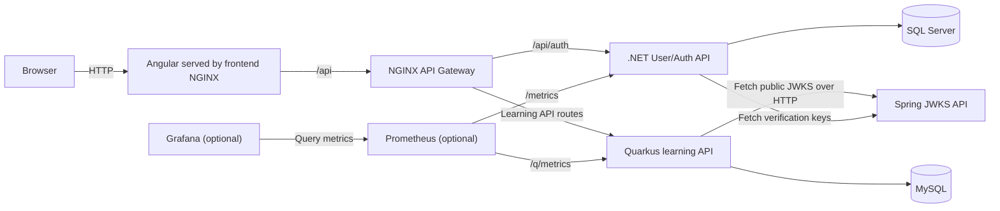

# Japanese Learning Application

Japanese Learning is a microservices-based application for account registration and sign-in, JLPT vocabulary and lesson browsing, flashcard study, and Kanji Context Quizzes with history and progress. Administration features cover vocabulary editing/import, lesson import, and quiz question management.

The system separates the browser application, account/token management, and learning APIs into independently built repositories. This root repository pins those repositories as Git submodules and owns full-system orchestration, the API Gateway, database initialization/migrations, monitoring configuration, and deployment tools.

Account-management and settings screens are placeholders. Password reset, email verification, profile editing, and role-management APIs are not implemented. Quarkus learning features run together as **one backend application**, not separate services.

## System architecture

The implemented API Gateway is **root-managed NGINX**, not a Quarkus application.



Angular uses same-origin `/api` requests. Containerized frontend NGINX forwards them to `gateway:8080`; Angular's development proxy forwards them to `http://localhost:8080`. Only the proxies resolve Docker service names. The APIs have separate databases; learning requests derive user identity from JWT claims rather than querying SQL Server or calling Auth for every request.

The base Compose stack shares its default network. Production adds internal network segmentation and requires a separately configured host HTTPS reverse proxy; see [Deployment](#deployment).

## Technology stack

| Area | Technology |
| --- | --- |
| Frontend | Angular 22.1.1, TypeScript 6.0.3, Tailwind CSS 4 |
| Accounts/authentication | ASP.NET Core / .NET 9, Dapper, RS256 JWT |
| Learning API | Quarkus 3.38.2, Java 17, Hibernate Reactive/Panache, MySQL client |
| API Gateway / static hosting | NGINX; Gateway uses digest-pinned `nginx:stable-alpine` |
| Databases | Digest-pinned MySQL 8.4 and SQL Server 2022 images |
| Schema migrations | External Flyway containers, image pinned by digest (tag is `latest`) |
| Optional monitoring | Prometheus 3.14.0, Grafana 13.2.2 |
| Build / operations | Git submodules, Docker Compose, npm, Maven Wrapper, .NET CLI, Python, PowerShell/Bash key helpers |

Service-specific dependency versions and conventions live in the submodule READMEs.

## Repository structure

```text
.
|-- README.md
|-- .gitmodules                      # Submodule paths and remotes
|-- .env.example                     # Local Compose configuration template
|-- .gitignore / .gitattributes       # Secret exclusions and Git settings
|-- docker-compose.yml               # Complete local stack
|-- compose.observability.yml         # Optional Prometheus/Grafana
|-- compose.production.yml           # Single-host production overlay
|-- compose.production-observability.yml
|-- angular/                         # Frontend Git submodule
|-- dotnet/                          # User/Auth Git submodule
|-- quarkus/                         # Learning API Git submodule
|-- gateway/nginx.conf               # API routes, limits, headers and logs
|-- observability/                   # Scrapes, Grafana provisioning/dashboard
|-- deployment/                      # Production template, runbook, E2E report
|-- scripts/                         # Key helpers, operations and verification
`-- secrets/                         # Ignored public keys and private/<service> keys
```

Local `.env`, additional `.env.*` files, and `.vscode/` are ignored workspace configuration, not shared deployment inputs. Compose reads `.env` by default; another environment file requires explicit selection. No root Dockerfile, CI/CD workflow, Kubernetes manifests, message broker, or centralized log collector is checked in.

## Services and components

| Compose service | Responsibility and dependencies | Documentation |
| --- | --- | --- |
| `frontend` | Compiled Angular served by NGINX; waits for Gateway health | [Angular](angular/README.md) |
| `gateway` | Routes API traffic, limits requests and supplies correlation/security headers; waits for both APIs | [NGINX configuration](gateway/nginx.conf) |
| `user-api` | Accounts, login, token issuance/refresh/logout, remote JWKS verification; requires SQL Server, migrations and RSA keys | [.NET](dotnet/README.md) |
| `vocabulary-api` | Vocabulary, lessons, flashcards, quiz administration/gameplay/history/progress; requires MySQL, migrations and independent JWKS | [Quarkus](quarkus/README.md) |
| `mysql` | Learning data, including quiz state | [Base Compose](docker-compose.yml) |
| `sqlserver` | Users, password hashes and hashed refresh tokens | [Base Compose](docker-compose.yml) |
| `sqlserver-init` | Creates the configured SQL database if absent | [Base Compose](docker-compose.yml) |
| `flyway-user`, `flyway-vocabulary` | One-shot schema migrations from the respective submodules | [Base Compose](docker-compose.yml) |
| `prometheus`, `grafana` | Optional API metrics collection and provisioned dashboard | [Monitoring overlay](compose.observability.yml) |
| `fluent-bit`, `opensearch` | Collect and index JSON logs from the three APIs | [Logging guide](observability/logging/README.md) |
| `opensearch-dashboards`, `logs-ui` | Authenticated log viewer on loopback port 5601 | [Logging guide](observability/logging/README.md) |
| `logging-init`, `logging-ui-init` | One-shot mappings, retention and Discover setup | [Logging guide](observability/logging/README.md) |

### Gateway routes

The following paths and their descendants are forwarded unchanged, including query parameters and Authorization:

| Path | Destination |
| --- | --- |
| `/api/auth` | `user-api:8080` |
| `/api/v1/flashcards`, `/api/v1/jlpt-levels`, `/api/v1/lessons` | `vocabulary-api:8080` |
| `/api/vocabularies` (including import) | `vocabulary-api:8080` |
| `/api/v1/admin/vocabularies` | `vocabulary-api:8080` |
| `/api/v1/kanji-quiz`, `/api/v1/admin/kanji-quiz/questions` | `vocabulary-api:8080` |
| `/health` | Gateway process health only |
| Other paths | 404 |

Backend Swagger, health, metrics and JWKS are not routed through the Gateway.

## Prerequisites

**Containerized execution:** Git, Docker with Linux containers, and Docker Compose v2. Production overlays require Compose **2.24.4 or later**. Image builds supply application SDKs; host Node/Java/.NET installations are unnecessary unless developing natively or using the PowerShell key generator.

The included log-search stack needs Python 3.10+ for initial credential generation,
about 4 GiB additional RAM, and Linux `vm.max_map_count >= 262144`. See the logging
guide for resource sizing and the authenticated viewer.

**Native development:** install only the tools for the component being changed:

- Angular: Node.js **24.15.0 or newer within 24.x**, npm **11.12.1**.
- .NET: **.NET 9 SDK**; the HTTPS launch profile also needs a trusted development certificate.
- Quarkus: **JDK 17** with `JAVA_HOME`; use the supplied Maven Wrapper.
- Root Python tooling: Python **3.10+**. Key helpers require PowerShell plus .NET 9, or Bash/OpenSSL for the production Linux helper.

Native backends still need initialized databases and matching authentication configuration. See the [production runbook](deployment/README.md) for Linux platform, capacity and host-tool requirements.

## Getting started

Run root commands from this directory. The following starts the complete local system, including migrations.

1. Clone and initialize the pinned submodule revisions:

   ```sh
   git clone --recurse-submodules https://github.com/phat-dat-ag/japanese-learning.git
   cd japanese-learning
   git submodule update --init --recursive
   ```

2. Copy the environment template, unless a configured `.env` already exists:

   ```powershell
   Copy-Item .env.example .env
   ```

   On Unix use `cp .env.example .env`. Edit the file privately and set `MYSQL_ROOT_PASSWORD`, `MYSQL_PASSWORD`, and `MSSQL_SA_PASSWORD`. Preserve existing credentials when reusing database volumes. See [Environment configuration](#environment-configuration).

3. For a new deployment, provision the matching indexed User key pairs and public filenames described in [JWKS setup](docs/JWKS.md). Preserve existing deployments' keys. The following helper provisions a single pair; adapt individual Compose file mounts and indexed examples before using its output. Provision a matching, unencrypted RSA PEM pair of at least 2048 bits at `secrets/private/user-api/private.pem` and `secrets/public/user-api-public.pem`. See [key storage conventions](docs/SECRETS.md). Alternatively, with PowerShell and .NET 9 installed:

   ```powershell
   pwsh -File ./scripts/generate-jwt-keys.ps1
   ```

   The helper refuses existing keys. Both files must be readable by the .NET container user (UID 1654), with directory traversal permission. On Linux, grant narrowly scoped ownership/ACL access; the generated private key starts owner-only. Restart Auth after replacing keys.

4. Validate and start:

   ```sh
   python -B scripts/setup-log-access.py
   docker compose config --quiet
   docker compose up -d --build
   docker compose ps -a
   ```

   Compose starts databases, runs initialization/migrations, then gates API, Gateway and frontend startup on readiness. Initialization and Flyway containers should finish with exit code **0**; they do not remain running.

5. Open **http://localhost:8088**, register, then sign in. Registration creates a `User`, not an `Admin`. No automatic Admin provisioning procedure is supplied. Fresh migrations seed reference data, but do not populate lessons, vocabulary or quiz questions; an authorized Admin must supply learning content.

### Local addresses

All base Compose published ports bind to `127.0.0.1`. These are defaults; the environment variables below can change them.

| Component | Host address | Port variable |
| --- | --- | --- |
| Frontend | http://localhost:8088 | `FRONTEND_PORT` |
| Gateway | http://localhost:8080 | `GATEWAY_HOST_PORT` |
| User/Auth API | http://localhost:8081 | `USER_API_HOST_PORT` |
| Learning API | http://localhost:8082 | `VOCABULARY_API_HOST_PORT` |
| MySQL | `localhost:3306` | `MYSQL_HOST_PORT` |
| SQL Server | `localhost:1433` | `MSSQL_HOST_PORT` |

Host port overrides do not change internal service ports. Changing `GATEWAY_HOST_PORT` also requires updating Angular's development proxy when using `npm start`.

## Environment configuration

[.env.example](.env.example) supplies local Compose defaults. Root `.env` is used for Compose interpolation; it is not automatically loaded by native .NET or Angular processes. Shell variables take precedence over dotenv values. Keep actual environment files and PEM files out of Git and never publish resolved Compose output; use `config --quiet`.

| Settings | Consumers / behavior |
| --- | --- |
| `MYSQL_ROOT_PASSWORD`, `MYSQL_PASSWORD`, `MYSQL_DATABASE`, `MYSQL_USER` | MySQL initialization; application user/password also used by vocabulary Flyway and Quarkus |
| `MSSQL_SA_PASSWORD`, `MSSQL_DATABASE` | SQL Server initialization, user Flyway and .NET; database defaults to `JapaneseLearningUser` |
| `JWT_ISSUER`, `JWT_AUDIENCE` | Shared .NET issuance and Quarkus verification contract |
| `USER_API_SIGNING_ENV_FILE`, `JWT_ACCESS_TOKEN_EXPIRATION_MINUTES` | Required indexed signing-key file and access lifetime |
| `QUARKUS_MIGRATION_PATH`, `DOTNET_MIGRATION_PATH` | Read-only Flyway SQL mounts; defaults point into the submodules |
| Host port variables above | Local published ports |
| `GRAFANA_ADMIN_PASSWORD` | Required only with the monitoring overlay |
| `MSSQL_PID`, `RELEASE_TAG`, `JWT_REFRESH_TOKEN_EXPIRATION_DAYS` | Consumed by the production overlay; present in the local template but **not passed by base Compose** |

MySQL names accept 1–64 ASCII letters, digits, underscores or hyphens. Its initializer rejects blank passwords, quotes, backslashes and control characters. SQL Server requires a password accepted by its password policy. Single-quote dotenv values containing `$` to prevent interpolation. Editing dotenv does not rotate credentials already stored in database volumes.

Compose supplies .NET split `Database__*` settings, signing PEM paths, and `Jwt__JwksUrl`. Quarkus receives `DB_USERNAME`, `DB_PASSWORD`, `DB_REACTIVE_URL=mysql://mysql:3306/<database>`, `AUTH_SERVER_URL=http://jwks-api:8080`, and `AUTH_JWKS_URL=http://jwks-api:8080/api/v1/jwks/user`. Private signing keys are mounted only into .NET; JWKS binds only the three configured public files read-only; see [owner-specific configuration](docs/JWKS.md).

For native configuration, follow the [.NET environment guide](dotnet/README.md#environment-configuration) and [Quarkus environment guide](quarkus/README.md#environment-configuration). Use host database addresses and explicit matching issuer/audience values; .NET accepts either a full connection string or split settings, not both. Angular has no dotenv or runtime environment loader and needs no secrets.

## Local development workflow

### Angular locally, backends in containers

```sh
docker compose up -d --build gateway
cd angular
npm ci
npm start
```

Gateway dependencies bring up both APIs, databases and migration jobs. Open http://localhost:4200. The development proxy keeps browser API calls same-origin; starting Angular alone does not start backend services.

### Native backend development

Start database infrastructure independently:

```sh
docker compose up -d mysql sqlserver
docker compose up -d flyway-user flyway-vocabulary
docker compose ps -a
```

Wait for both Flyway jobs and `sqlserver-init` to exit successfully before starting APIs. Configure local credentials and key paths as described above, then:

1. In `dotnet/`, use `dotnet run --project src/JapaneseLearning.User.Api --launch-profile https`. This profile exposes HTTPS 7066 and HTTP 5116. For intentional HTTP-only development, set `Http__RedirectToHttps=false` and use `--launch-profile http`.
2. In `quarkus/`, point the database at localhost and JWKS at the independent service on port 8083, then use `./mvnw quarkus:dev` (PowerShell: `.\mvnw.cmd quarkus:dev`).

Quarkus defaults to port 8080, which conflicts with the container Gateway. The checked-in Gateway targets Docker service names, not host-native APIs: no root override wiring a fully native stack through that Gateway is supplied. Use native services directly for service development; use the container backend workflow above for complete browser integration.

### Rebuild, inspect and stop

```sh
docker compose build
docker compose up -d --build
docker compose logs --tail 100 gateway user-api vocabulary-api frontend
docker compose exec gateway nginx -t
docker compose stop
```

For schema changes, explicitly rerun the relevant Flyway job before restarting dependent APIs; image rebuilds do not establish migration success. The production operator handles that order automatically.

`docker compose down` removes containers/network while retaining named volumes. Adding `-v` deletes database and log volumes; it is not a troubleshooting step.

| Check | Default local URL |
| --- | --- |
| Frontend / Gateway process health | http://localhost:8088/health / http://localhost:8080/health |
| Auth liveness / readiness | http://localhost:8081/health/live / http://localhost:8081/health/ready |
| Learning liveness / readiness | http://localhost:8082/q/health/live / http://localhost:8082/q/health/ready |
| Auth Swagger | http://localhost:8081/swagger |
| Learning Swagger / OpenAPI | http://localhost:8082/q/swagger-ui / http://localhost:8082/q/openapi |
| Public JWKS (independent service) | http://localhost:8083/api/v1/jwks/user |

Readiness checks database connectivity, not every business query or migration version. Frontend/Gateway health checks only their own NGINX processes. Compose gates initial startup; it does not remove traffic from unhealthy services or restart a container merely because it is unhealthy.

## Authentication and request flow

1. Angular sends registration/login requests through its same-origin proxy and Gateway to .NET.
2. .NET verifies accounts in SQL Server and returns an RS256 access token and refresh token. Angular calls `/api/auth/me` for identity/role and stores session state **in memory only**; reloading requires sign-in.
3. Angular attaches the bearer token to protected API requests. Gateway forwards it unchanged and performs **no JWT or role validation**.
4. .NET and Quarkus validate protected routes using public keys from the independent Spring JWKS service. .NET remains the RS256 issuer; issuer, audience, lifetime, User/Admin policies and subject-scoped quiz ownership remain unchanged.
5. Angular coordinates refresh after a 401 and retries once. Logout revokes the refresh token; already-issued access tokens remain valid until expiry.

JWKS is fetched lazily and cached by both verifiers. Cached-key verification can continue during a JWKS outage; a required key fetch cannot. The internal endpoint is `http://jwks-api:8080/api/v1/jwks/user`; the former .NET JWKS endpoint is removed. No private key is shared with JWKS, Gateway, Quarkus or Angular. See [JWKS setup and migration](docs/JWKS.md) and the submodule authentication sections for configuration, rotation and availability details.

Gateway enforces a 10 MiB request-body limit, timeouts, security headers and bounded correlation IDs. Its sustained limits are 20 API requests/second, 10 combined login/registration requests/minute, 60 refreshes/minute and 2 vocabulary imports/minute, with configured bursts and connection caps. Limits use the TCP peer: browsers behind the frontend proxy share its budgets. HTTP 429 requires backoff. The import-specific budget covers `/api/vocabularies/import`, not every feature import endpoint. See [gateway/nginx.conf](gateway/nginx.conf) for exact rules.

## Infrastructure and databases

Startup dependencies are:

```text
MySQL healthy -> vocabulary Flyway succeeds ----------------------+
SQL Server healthy -> SQL init succeeds -> user Flyway succeeds   |
                                         -> Auth ready ----------+-> Quarkus ready
Auth ready + Quarkus ready -> Gateway healthy -> Frontend
```

Migrations are mounted from [dotnet/db/migration](dotnet/db/migration) and [quarkus/src/main/resources/db/migration](quarkus/src/main/resources/db/migration). Neither API applies migrations at startup. The READMEs document SQL migrations V1–V4 and MySQL V1–V8. Do not edit previously applied migrations.

Named volumes preserve `mysql_data`, `sqlserver_data`, `user_api_logs` and `vocabulary_api_logs`. They are scoped by the Compose project name; changing that name selects different storage. Keep the project name stable. Volumes are not backups.

The current .NET runtime and user migration job use SQL `sa`; the MySQL application account also runs migrations. Separate runtime/migration privileges require coordinated database configuration. Containers use non-root users, read-only root filesystems, explicit writable mounts, resource limits and dropped capabilities; SQL Server retains `NET_BIND_SERVICE`.

### Optional monitoring and logging

Set `GRAFANA_ADMIN_PASSWORD` in `.env`, then:

```sh
docker compose -f docker-compose.yml -f compose.observability.yml config --quiet
docker compose -f docker-compose.yml -f compose.observability.yml up -d --build
```

Prometheus is at http://localhost:9090 and Grafana at http://localhost:3000 (user `admin`, configured password), both loopback-only. Prometheus scrapes `user-api:8080/metrics` and `vocabulary-api:8080/q/metrics` every 15 seconds. Grafana provisions the **Japanese Learning APIs** dashboard. Monitoring adds `prometheus_data` and `grafana_data`; Prometheus retention is bounded to two days / 512 MB. Scrape availability does not prove database readiness.

Use the same two-file Compose combination for monitoring status/stop operations. Omitting the overlay later does not stop existing monitoring containers. Changing the initial Grafana password variable does not rotate an existing account.

Both APIs write console and retained file logs. Gateway logs fixed route families, status, timings and correlation IDs instead of request bodies or arbitrary URLs. Use `X-Correlation-ID` to relate proxy/backend events. API file retention is documented in each submodule; Quarkus age-based retention does not impose a total disk quota. Production additionally rotates Docker logs at 10 MB × 5 files per service. No central logging or tracing backend is provided.

## Build and testing

Run from the stated directory; detailed test prerequisites and opt-in integration suites are in the linked READMEs.

| Directory | Build | Tests |
| --- | --- | --- |
| Root | `docker compose build` | No unified application test command |
| `angular/` | `npm ci`, then `npm run build` | `npm test -- --watch=false` |
| `dotnet/` | `dotnet build JapaneseLearning.User.sln -c Release` | `dotnet test JapaneseLearning.User.sln -c Release` |
| `quarkus/` | `./mvnw package` | `./mvnw verify "-Dquarkus.http.test-port=0"` |

Container builds are not a substitute for service test suites. Use `mvnw.cmd` on Windows. Root checks include:

- `docker compose config --quiet`: Compose syntax/interpolation validation without displaying secrets.
- `python -B scripts/test-production.py`: mocked deployment failure/order tests; no Docker calls.
- `python -B scripts/verify-configuration.py`: configuration/secret-exclusion audit; `--startup` additionally starts disposable test containers.
- `python -B scripts/verify-correlation.py`: checks the running local stack without application data writes.
- [Gateway security](scripts/verify-gateway-security.py), [rate limits](scripts/verify-gateway-rate-limits.py), [container hardening](scripts/verify-container-hardening.py) and [observability](scripts/verify-observability.py) scripts provide targeted runtime checks; some create isolated containers.
- [Production verification](scripts/verify-production.py) and [fresh E2E verification](scripts/verify-final-e2e.py) build/use isolated deployments and retain test resources. Follow the [runbook](deployment/README.md) before running them.

Some integration tests create accounts/content or retain test volumes. Their prerequisites and isolation differ; they are not interchangeable smoke tests. The [historical E2E report](deployment/FINAL-E2E-VERIFICATION.md) records an earlier working tree, not proof that the current checkout passes.

## Deployment

The supported resources describe a **single Linux host with maintenance-window deployments**. Follow [deployment/README.md](deployment/README.md) for provisioning, HTTPS, backups, updates and rollback.

Copy [deployment/production.env.example](deployment/production.env.example) to protected `.env.production`, provision keys, choose a production-permitted SQL Server edition and a unique `RELEASE_TAG`, then run from the root:

```sh
python3 -B scripts/production.py validate
python3 -B scripts/production.py build
python3 -B scripts/production.py deploy
python3 -B scripts/production.py status
python3 -B scripts/production.py verify
```

The operator combines base and production Compose files, builds locally tagged `japanese-learning/{frontend,user-api,vocabulary-api}:<RELEASE_TAG>` images, stops application traffic, recreates init/migration jobs, and starts services in readiness order. Reusing existing release tags is rejected. No registry publishing or CI/CD pipeline is configured.

Production removes backend, database, Gateway and Prometheus host ports. It uses separate edge/frontend/API/database networks; only frontend HTTP remains at loopback port 8088. A host-managed TLS reverse proxy, certificates, domain and firewall are external requirements, not supplied configurations.

For optional monitoring, consistently add `--monitoring` before the operator action; it applies both monitoring overlays in the required order. Grafana remains loopback-only for SSH-tunnel access. Keep the production project name/configuration stable, preserve keys and database backups, and use the runbook's migration-compatible rollback procedure.

## Git submodule workflow

[.gitmodules](.gitmodules) maps `angular`, `dotnet` and `quarkus` to the corresponding `phat-dat-ag/japanese-learning-*` GitHub repositories. Each has independent history; the root records a commit reference, not its files.

```sh
# After cloning without --recurse-submodules, or pulling a root revision:
git submodule update --init --recursive
git submodule status
git status --short

# Intentionally select upstream changes (review before recording):
git submodule update --remote angular
# All three, only when deliberately upgrading them together:
git submodule update --remote
```

For reproducible onboarding/releases, use pinned revisions via `--init --recursive`, not `--remote`. A leading `-` in submodule status means uninitialized; `+` means the checkout differs from the root pin. Preserve local submodule work before switching revisions.

To contribute, create a branch inside the relevant submodule, commit and push there first, then record its new revision in the root. Example:

```sh
git -C angular switch -c feature/example
# Edit and commit intended files inside angular, then:
git -C angular push -u origin feature/example
git add angular
git commit -m "chore: update Angular submodule"
```

Push the root commit through the normal review workflow after the referenced submodule commit is available remotely.

## Troubleshooting

| Symptom | Check / action |
| --- | --- |
| Missing build context or migration files | Run `git submodule update --init --recursive`; verify submodule status |
| Compose reports required variables missing | Create/fill `.env`; check shell overrides and validate with `config --quiet` |
| Auth fails before HTTP starts | Check database settings, matching RSA files and UID 1654 read/traversal access |
| Migration job exits nonzero | Inspect its restricted logs locally; verify target database/credentials and migration history before restarting dependent APIs |
| Database authentication fails after editing dotenv | Persisted credentials did not change; restore matching configuration or perform deliberate database credential rotation |
| Port already allocated | Check the host-port variables; native Quarkus uses 8080 and its default test port can conflict with Auth on 8081 |
| Gateway/frontend returns 502 or 504 | Check API readiness and upstream logs; NGINX health alone does not prove backend availability |
| Angular development API calls fail | Ensure Gateway is on the configured port, requests use `/api`, and restart `npm start` after proxy edits |
| 401 / 403 | Check token lifetime, issuer/audience/JWKS and clocks / required role; registered accounts start as User |
| 429 during sign-in or imports | Wait for rate budgets to recover; frontend-proxied browsers share Gateway limits |
| Fresh application has no learning content | Migrations seed reference data only; create/import content with an authorized Admin |
| Sign-in disappears after reload | Expected: Angular stores its session in memory |
| Filesystem permission failure | Check non-root mount ownership; do not delete database volumes or make private keys world-readable |

## Documentation index and known gaps

- [Angular README](angular/README.md): frontend setup, session behavior, UI features and browser tests.
- [.NET README](dotnet/README.md): account/token contracts, SQL configuration, keys and tests.
- [Quarkus README](quarkus/README.md): learning APIs, authorization, migrations and feature documentation links.
- [Production runbook](deployment/README.md): deployment, monitoring, backups and rollback.
- [Historical E2E report](deployment/FINAL-E2E-VERIFICATION.md): recorded results and host-specific limits.
- [Local environment template](.env.example) and [production template](deployment/production.env.example).
- [Gateway configuration](gateway/nginx.conf), [Prometheus configuration](observability/prometheus.yml) and [Grafana dashboard](observability/grafana/dashboards/apis.json).

Known documentation/operational gaps:

- The .NET README attributes Gateway ownership to Quarkus; root configuration establishes NGINX as the actual Gateway. Submodule statements about absent orchestration apply to their standalone repositories.
- No supported first-Admin provisioning workflow or automatic learning-content seed is documented.
- No checked-in Gateway override connects a complete host-native backend stack.
- The September 2026 E2E report covers MySQL migrations through V5; the current Quarkus README documents V8 and quiz features. Current full-stack behavior needs fresh verification.
- `.env.example` repeats `FRONTEND_PORT` and includes production-only variables; the environment table above identifies their actual consumers.
- Production domain/TLS configuration, backup restoration, host permissions/firewall and capacity must be verified on the target host. The repository does not establish that a production environment is deployed.

## Centralized application logs

Fluent Bit, OpenSearch and authenticated OpenSearch Dashboards in the base Compose file collect
JWKS, .NET and Quarkus JSON logs. See [log search setup](observability/logging/README.md)
for local/production commands, credentials, retention, queries and verification.
