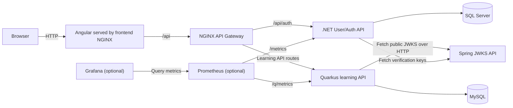

# Japanese Learning Application

Japanese Learning is a microservices-based application for account registration and sign-in, JLPT vocabulary and lesson browsing, flashcard study, and Kanji Context Quizzes with history and progress. Administration features cover vocabulary editing/import, lesson import, and quiz question management.

The system separates the browser application, account/token management, and learning APIs into independently built repositories. This root repository pins those repositories as Git submodules and owns full-system orchestration, the API Gateway, database initialization/migrations, monitoring configuration, and deployment tools.

Account-management and settings screens are placeholders. Password reset, email verification, profile editing, and role-management APIs are not implemented. Quarkus learning features run together as **one backend application**, not separate services.

## System architecture

The implemented API Gateway is **root-managed NGINX**, not a Quarkus application.



Angular uses same-origin `/api` requests. Containerized frontend NGINX forwards them to `gateway:8080`; Angular's development proxy forwards them to `http://localhost:8080`. Only the proxies resolve Docker service names. The APIs have separate databases; learning requests derive user identity from JWT claims rather than querying SQL Server or calling Auth for every request.

The base Compose stack shares its default network. Production adds internal network segmentation and requires a separately configured host HTTPS reverse proxy; see [Deployment](#deployment).

## Technology stack

| Area | Technology |
| --- | --- |
| Frontend | Angular 22.1.1, TypeScript 6.0.3, Tailwind CSS 4 |
| Accounts/authentication | ASP.NET Core / .NET 9, Dapper, RS256 JWT |
| Learning API | Quarkus 3.38.2, Java 17, Hibernate Reactive/Panache, MySQL client |
| API Gateway / static hosting | NGINX; Gateway uses digest-pinned `nginx:stable-alpine` |
| Databases | Digest-pinned MySQL 8.4 and SQL Server 2022 images |
| Schema migrations | External Flyway containers, image pinned by digest (tag is `latest`) |
| Optional monitoring | Prometheus 3.14.0, Grafana 13.2.2 |
| Build / operations | Git submodules, Docker Compose, npm, Maven Wrapper, .NET CLI, Python, PowerShell/Bash key helpers |

Service-specific dependency versions and conventions live in the submodule READMEs.

## Repository structure

```text
.
|-- README.md
|-- .gitmodules                      # Submodule paths and remotes
|-- .env.example                     # Local Compose configuration template
|-- .gitignore / .gitattributes       # Secret exclusions and Git settings
|-- docker-compose.yml               # Complete local stack
|-- compose.observability.yml         # Optional Prometheus/Grafana
|-- compose.production.yml           # Single-host production overlay
|-- compose.production-observability.yml
|-- angular/                         # Frontend Git submodule
|-- dotnet/                          # User/Auth Git submodule
|-- quarkus/                         # Learning API Git submodule
|-- gateway/nginx.conf               # API routes, limits, headers and logs
|-- observability/                   # Scrapes, Grafana provisioning/dashboard
|-- deployment/                      # Production template, runbook, E2E report
|-- scripts/                         # Key helpers, operations and verification
`-- secrets/                         # Ignored public keys and private/<service> keys
```

Local `.env`, additional `.env.*` files, and `.vscode/` are ignored workspace configuration, not shared deployment inputs. Compose reads `.env` by default; another environment file requires explicit selection. No root Dockerfile, CI/CD workflow, Kubernetes manifests, message broker, or centralized log collector is checked in.

## Services and components

| Compose service | Responsibility and dependencies | Documentation |
| --- | --- | --- |
| `frontend` | Compiled Angular served by NGINX; waits for Gateway health | [Angular](angular/README.md) |
| `gateway` | Routes API traffic, limits requests and supplies correlation/security headers; waits for both APIs | [NGINX configuration](gateway/nginx.conf) |
| `user-api` | Accounts, login, token issuance/refresh/logout, remote JWKS verification; requires SQL Server, migrations and RSA keys | [.NET](dotnet/README.md) |
| `vocabulary-api` | Vocabulary, lessons, flashcards, quiz administration/gameplay/history/progress; requires MySQL, migrations and independent JWKS | [Quarkus](quarkus/README.md) |
| `mysql` | Learning data, including quiz state | [Base Compose](docker-compose.yml) |
| `sqlserver` | Users, password hashes and hashed refresh tokens | [Base Compose](docker-compose.yml) |
| `sqlserver-init` | Creates the configured SQL database if absent | [Base Compose](docker-compose.yml) |
| `flyway-user`, `flyway-vocabulary` | One-shot schema migrations from the respective submodules | [Base Compose](docker-compose.yml) |
| `prometheus`, `grafana` | Optional API metrics collection and provisioned dashboard | [Monitoring overlay](compose.observability.yml) |
| `fluent-bit`, `opensearch` | Collect and index JSON logs from the three APIs | [Logging guide](observability/logging/README.md) |
| `opensearch-dashboards`, `logs-ui` | Authenticated log viewer on loopback port 5601 | [Logging guide](observability/logging/README.md) |
| `logging-init`, `logging-ui-init` | One-shot mappings, retention and Discover setup | [Logging guide](observability/logging/README.md) |

### Gateway routes

The following paths and their descendants are forwarded unchanged, including query parameters and Authorization:

| Path | Destination |
| --- | --- |
| `/api/auth` | `user-api:8080` |
| `/api/v1/flashcards`, `/api/v1/jlpt-levels`, `/api/v1/lessons` | `vocabulary-api:8080` |
| `/api/vocabularies` (including import) | `vocabulary-api:8080` |
| `/api/v1/admin/vocabularies` | `vocabulary-api:8080` |
| `/api/v1/kanji-quiz`, `/api/v1/admin/kanji-quiz/questions` | `vocabulary-api:8080` |
| `/health` | Gateway process health only |
| Other paths | 404 |

Backend Swagger, health, metrics and JWKS are not routed through the Gateway.

## Prerequisites

**Containerized execution:** Git, Docker with Linux containers, and Docker Compose v2. Production overlays require Compose **2.24.4 or later**. Image builds supply application SDKs; host Node/Java/.NET installations are unnecessary unless developing natively or using the PowerShell key generator.

The included log-search stack needs Python 3.10+ for initial credential generation,
about 4 GiB additional RAM, and Linux `vm.max_map_count >= 262144`. See the logging
guide for resource sizing and the authenticated viewer.

**Native development:** install only the tools for the component being changed:

- Angular: Node.js **24.15.0 or newer within 24.x**, npm **11.12.1**.
- .NET: **.NET 9 SDK**; the HTTPS launch profile also needs a trusted development certificate.
- Quarkus: **JDK 17** with `JAVA_HOME`; use the supplied Maven Wrapper.
- Root Python tooling: Python **3.10+**. Key helpers require PowerShell plus .NET 9, or Bash/OpenSSL for the production Linux helper.

Native backends still need initialized databases and matching authentication configuration. See the [production runbook](deployment/README.md) for Linux platform, capacity and host-tool requirements.

## Getting started

For a **new local deployment** on Windows, use PowerShell from the root repository.
Install Git (including OpenSSL), Python 3.10+ and Docker Desktop with Linux containers
and a current Compose plugin. Docker builds supply Node, Java and .NET; host SDKs
are only needed for native development. Allow sufficient Docker memory/disk for
both databases, OpenSearch and image builds (see the deployment resource guidance).
Do not run these first-time generators against an existing deployment.

1. Clone the root and all four pinned submodules:

   ```powershell
   git clone --recurse-submodules https://github.com/phat-dat-ag/japanese-learning.git
   cd japanese-learning
   git submodule update --init --recursive
   git submodule status
   python -B scripts/initialize-environment.py
   ```

   This creates absent static dotenv files, including root service inputs and child
   native templates, without replacing existing files. Child `.env` files are not
   required by the root Docker builds. Do not copy `.env.logging.example` to
   `.env.logging`; that receipt must be generated with its matching bcrypt file.

2. Edit root `.env` privately. Supply `MYSQL_ROOT_PASSWORD`, `MYSQL_PASSWORD`,
   `MSSQL_SA_PASSWORD` and `GRAFANA_ADMIN_PASSWORD` with distinct strong credentials.
   SQL Server requires a strong password satisfying its complexity policy. Use
   dotenv quoting when values contain `$` or `#`; never paste credentials in chat.
   Set `DOCKER_DATA_HOST_PATH` to the **existing directory containing this machine's
   Docker Desktop disk image**, as configured in Docker Desktop's disk-image
   location settings. The example's `D:/...` location is machine-specific; do not
   create an empty directory just to pass validation. Linux hosts must select the
   actual Docker backing filesystem directory. Review published ports for conflicts
   and choose one stable `COMPOSE_PROJECT_NAME` before first startup.

   The commands below use `jp_learning_dev`, the example's new-clone project name.
   **This repaired workstation uses `jp_dev`; use `-p jp_dev` here instead.** Never
   change project names to fix a startup error: that selects different volumes.

3. Create fresh matching application keys and P07 security material once:

   ```powershell
   python -B scripts/generate-compose-jwt-keys.py --new-local-deployment
   python -B scripts/provision-p07-local.py --apply
   python -B scripts/setup-log-access.py
   ```

   The first helper creates the three indexed key pairs expected by the unmodified
   Compose templates. The older PowerShell single-key helper does not match those
   filenames. No key IDs, active selection or existing keys are overwritten. The
   P07 helper creates its own separate TLS/account material, fills blank P07
   credentials, and refuses existing real security files. Viewer credentials are
   generated into ignored `.env.logging`; read them locally, never print them.
   On Linux, generating application keys needs permission to set group 1654 and
   private-directory traversal; follow [key permissions](docs/SECRETS.md).

4. Check paths, then bootstrap only OpenSearch before starting its clients:

   ```powershell
   python -B scripts/preflight-compose.py --project jp_learning_dev
   docker compose -p jp_learning_dev up -d --build --no-deps opensearch
   python -B scripts/bootstrap-p07-local.py --project jp_learning_dev
   ```

   Preflight rejects missing/empty files, directories mounted as files, blank
   required settings and missing indexed signing keys. It does not start containers.
   The bootstrap waits for TLS readiness and initializes P07 security accounts/roles.
   Starting everything before this step can leave logging services waiting or failing.

5. Start and verify the complete stack:

   ```powershell
   docker compose -p jp_learning_dev config --quiet
   docker compose -p jp_learning_dev up -d --build
   docker compose -p jp_learning_dev ps -a
   ```

   Databases start first, initialization/migration jobs must exit **0**, and APIs,
   Gateway and frontend must become healthy. `otel-collector`, `tempo` and
   `fluent-bit` have no Docker health check; a running state is not an end-to-end
   telemetry guarantee. Never use `down -v` or remove volumes to repair startup.

Open **http://localhost:8088** (or the `FRONTEND_PORT` chosen in `.env`). Register,
then sign in. Registration creates a User, not an Admin; fresh migrations do not
populate lessons, vocabulary or quiz questions. Logs UI defaults to port 5601 and
uses the generated viewer receipt. Current workstation overrides are frontend
8099 and Logs UI 5661.

For subsequent starts, keep the same project name and run only `preflight-compose.py`,
`docker compose ... config --quiet` and `docker compose ... up -d`. Do not rerun key,
P07 or viewer generators. If a new step fails, fix its reported cause before moving
on; parsing alone cannot verify database credentials or existing volume contents.

To **move an existing deployment** to another Windows machine, securely restore
its matching root dotenv files, `secrets/` material and database/observability
backups instead of running fresh generators. Git clone does not contain those
ignored files or Docker volume data. Do not borrow another project's credentials.
Native service development, local production-like and Linux release setup are
separate workflows described below and in the child READMEs.

### Local addresses

All base Compose published ports bind to `127.0.0.1`. These are defaults; the environment variables below can change them.

| Component | Host address | Port variable |
| --- | --- | --- |
| Frontend | http://localhost:8088 | `FRONTEND_PORT` |
| Gateway | http://localhost:8080 | `GATEWAY_HOST_PORT` |
| User/Auth API | http://localhost:8081 | `USER_API_HOST_PORT` |
| Learning API | http://localhost:8082 | `VOCABULARY_API_HOST_PORT` |
| MySQL | `localhost:3306` | `MYSQL_HOST_PORT` |
| SQL Server | `localhost:1433` | `MSSQL_HOST_PORT` |

Host port overrides do not change internal service ports. Changing `GATEWAY_HOST_PORT` also requires updating Angular's development proxy when using `npm start`.

## Environment configuration

Root `.env` is the default DEV interpolation file; its project name is
`jp_learning_dev`, matching the existing volumes. Templates are safe to commit;
all real `.env*` files, keys and `.local/` audit artifacts are ignored.
Never print `docker compose config` output: use `config --quiet`.

| Template / local pair | Purpose and loading |
| --- | --- |
| `.env.example` / `.env` | Complete Compose inputs, including fallback values; default DEV |
| `.env.db.production.example` / `.env.db.production` | Partial local production-like override; load **after** base |
| `.env.user-api.example` / `.env.user-api` | .NET indexed signing keys and runtime options; service `env_file` |
| `.env.jwks-api.example` / `.env.jwks-api` | Spring public-key list and runtime options; service `env_file` |
| `.env.vocabulary-api.example` / `.env.vocabulary-api` | Quarkus runtime options, import limits and SRS policy; service `env_file` |
| `.env.logging.example` / `.env.logging` | Generated viewer credential receipt; NGINX uses its matching bcrypt file, not dotenv |
| `.env.p07.example` / `.env.p07` | Security setup reference; not read by Compose. Setup generates `secrets/p07/*.env` instead |
| Child `.env.example` / `.env` | Native/service templates in Angular, Quarkus, .NET and Spring JWKS; loading differs below |
| `deployment/production.env.example` | Separate Linux release workflow, copied to ignored `.env.production` only when provisioning that workflow |
| `.env.user-api.production.example` / `.env.user-api.production` | Linux release signing input selected by the release template; provision production keys separately |
| `secrets/p07/{admin,writer,dashboards,monitor}.env.example` / matching `.env` files | Mandatory base Compose service inputs, including profiled production-like services |
| `quarkus/.env.docker.example` / `quarkus/.env.docker` | Explicit standalone Docker input; provide container-reachable database/Auth/JWKS URLs |

After cloning with submodules, run `python scripts/initialize-environment.py` from
the root on Windows or Linux. It creates missing static files only, including child
native files and optional Linux release inputs. It preserves existing values,
comments and local-only variables. Review reported blank settings; some are optional.
The complete [environment audit](docs/environment-file-audit.md) records consumers,
required inputs, generation exceptions and validation limits.

Before startup, securely provision `secrets/p07/admin.env` with
`P07_ADMIN_PASSWORD` for OpenSearch `administrator`, `writer.env` with
`P07_WRITER_PASSWORD` for `ingestion_writer`, and `dashboards.env` with
`P07_DASHBOARDS_PASSWORD` for `kibanaserver`. `monitor.env` requires a dedicated
`P07_MONITOR_TOKEN`, matching the securely provisioned `secrets/p07/monitor.token`.
The CA, node/admin/Dashboards certificates and keys, and OpenSearch accounts/roles
must match this deployment. Copying blank examples satisfies file paths only.
Recover existing credentials rather than generating replacements. The historical
`setup-p07-security.cjs` rewrites credential files and can regenerate CA material;
do not use it as an automatic missing-file repair. `.env.p07` is a reference file,
not the source of these service credentials. Keep generated `.env.logging` paired
with its htpasswd; do not initialize that receipt by copying its example.

If the original P07 material cannot be recovered, the explicitly authorized
[fresh local P07 procedure](docs/SECRETS.md#fresh-local-p07-provisioning) creates
matching certificates and accounts without changing application JWT keys or
deleting volumes. It refuses replacement of existing real security files.

Validate without displaying credentials:

```powershell
docker compose -p jp_dev config --quiet
docker compose --env-file .env --env-file .env.db.production -f docker-compose.yml -f compose.local-production.yml config --quiet
python scripts/verify-environment-portability.py
```

`jp_dev` is a parsing check; use the documented project names below for existing
storage. The portability check uses isolated template copies and synthetic
in-memory interpolation inputs. It does not start containers or establish runtime
readiness. Once required values and secure mounts are provisioned, use the existing
DEV or production-like start commands below; keep their environment files separate.

Use uppercase existing names; .NET nested options retain `Section__Property`.
Keep identity/ports, database, authentication, logging and telemetry groups together.
Blank required passwords/key paths have no safe defaults. Other values document
application defaults, including import limits, log retention and sampling. Indexed
key lists are extensible; preserve contiguous indices, IDs and existing active selection.
`APP_INSTANCE_ID` is an optional Quarkus instance override; leave it absent to use
container `HOSTNAME`. Image launcher variables and fixed privacy/metrics policies
remain image/framework configuration, rather than extra operator knobs.

Use the initializer above for missing-file repair. The historical
`audit-environment.cjs` checks root-level `.env*.example` name equality and does not
discover nested P07 files. Its `sync` mode rewrites local files; it is not the
preservation-safe initialization procedure. Review verified required additions to
existing files individually rather than regenerating local configuration.

Quarkus reads its working-directory `.env` through SmallRye. Spring, .NET,
Angular and npm do **not** automatically load these files: export the reviewed
values through the launcher/IDE environment for native runs. Angular's four
variables configure test runners only; its browser API root stays same-origin
`/api`. Do not copy secrets into public assets. Root service files are explicitly
loaded by Compose; `environment` overrides `env_file`, which overrides image
`ENV`. CLI interpolation files are not container environment injection.
Shell variables override interpolation files; clear conflicting shell overrides
before validation. Explicit `-p` overrides the project variable.

MySQL names accept 1–64 ASCII letters, digits, underscores or hyphens. Its initializer
rejects blank passwords, quotes, backslashes and control characters. SQL Server
enforces its password policy. Quote dotenv values containing `$` appropriately.
Changing an env password does not change a password stored in an existing volume.
Never set `Database__ConnectionString` alongside nonempty split database fields.

### Local DEV and production-like deployments

The installed Compose v5.7.0 accepts repeated `--env-file` and reset/override tags.
Production-like uses **both** files in order: later values win; using only the
override file does not merge the default `.env`. Keep DEV the normal default.
`compose.local-production.yml` is separate from the Linux release overlay
`compose.production.yml`; do not combine those two workflows.

Run from the root. These are operating commands for the user; validation did not
execute startup, stop or recreation. Review RAM headroom before starting a second
application stack (SQL Server alone reserves a 3 GiB container budget).

~~~powershell
# DEV (default .env)
docker compose up -d --build
docker compose config --quiet
docker compose ps -a
docker compose stop

# PRODUCTION-like (base, then overrides)
docker compose --env-file .env --env-file .env.db.production -f docker-compose.yml -f compose.local-production.yml up -d --build
docker compose --env-file .env --env-file .env.db.production -f docker-compose.yml -f compose.local-production.yml config --quiet
docker compose --env-file .env --env-file .env.db.production -f docker-compose.yml -f compose.local-production.yml ps -a
docker compose --env-file .env --env-file .env.db.production -f docker-compose.yml -f compose.local-production.yml stop

# Both concurrently: run the two respective up commands above; stop independently.
# Static, secret-safe validation; never starts containers
python scripts/verify-environment-portability.py
node scripts/verify-dual-environment.cjs
~~~

| Published loopback listener | Existing DEV | Local production-like |
| --- | --- | --- |
| Frontend | 8088 | 1888 |
| Gateway | 8080 | 1880 |
| User API | 8081 | 1881 |
| Vocabulary API | 8082 | 1882 |
| JWKS | 8083 | 1883 |
| MySQL | 3306 | 1806 |
| SQL Server | 1433 | 1833 |
| Prometheus / Grafana / Logs UI | 9091 / 3001 / 5601 | Shared, no second UI |

The audit resolved these local port assignments without disclosing credentials.
Base monitoring uses `MONITORING_PROMETHEUS_HOST_PORT` and
`MONITORING_GRAFANA_HOST_PORT`; older `PROMETHEUS_HOST_PORT` and
`GRAFANA_HOST_PORT` remain inputs to the legacy optional overlay. Their existing
local values were preserved. Root `APP_OTEL_EXPORT_ENABLED` is a retained legacy
assignment: Compose uses `JP_TRACE_EXPORT_ENABLED` for both runtime and the
Quarkus build argument. `FLUENT_BIT_STORAGE_LIMIT` is retained compatibility
configuration; the current P07 tail inputs use bounded memory buffering.

Projects `jp_learning_dev` and `jp_learning_prod` scope all application networks,
database/log volumes, Fluent Bit offsets and temporary files separately. Production-like
database names come from its override; neither database shares a storage volume.
Internal URLs remain `mysql`, `sqlserver`, `jwks-api` and `gateway` in the
owning project's default network. No fixed container names or shared mutable host
application mounts are introduced. Shared source/configuration binds are read-only.

Existing signing keys and public files are deliberately reused read-only, without
copying/rotating keys or changing issuer/audience/JWKS contracts. This is **one local
authentication trust domain**: a valid access token can be accepted in both
deployments, although their users/refresh-token data are separate. Do not use this
setup to test mutually untrusted tenants. A separate trust domain requires an
approved key/issuer/audience migration. No shared auth service is called: each
project has its own issuer process and public-only JWKS process.

### Optional shared observability

Base DEV owns OpenSearch, Prometheus, Tempo, Grafana and their storage. Local
production-like excludes them using an inactive `standalone-observability` profile;
do not enable that profile as part of this dual-stack workflow. Without the optional
sharing overlays, production logs stay in its own volumes, metrics remain internal,
and tracing export stays disabled. No second heavy observability stack is started.

Sharing needs the DEV provider overlay and two lightweight production shippers.
Applying the provider recreates Prometheus and Grafana to add a dedicated internal metrics
bridge and the dual-target scrape configuration. **This change was not applied to
the active stack.** Use only in an approved maintenance window; the provider must
exist before starting the shared consumer:

~~~powershell
docker compose -f docker-compose.yml -f compose.shared-provider.yml up -d --build
docker compose --env-file .env --env-file .env.db.production -f docker-compose.yml -f compose.local-production.yml -f compose.shared-consumer.yml up -d --build
# Inspect/stop using the same file sets; do not remove shared networks/volumes.
docker compose -f docker-compose.yml -f compose.shared-provider.yml ps -a
docker compose --env-file .env --env-file .env.db.production -f docker-compose.yml -f compose.local-production.yml -f compose.shared-consumer.yml ps -a
docker compose --env-file .env --env-file .env.db.production -f docker-compose.yml -f compose.local-production.yml -f compose.shared-consumer.yml stop
docker compose -f docker-compose.yml -f compose.shared-provider.yml stop
~~~

The internal metrics bridge connects only DEV Prometheus and production API
listeners; use unique `production-user-api` / `production-vocabulary-api` aliases.
No DEV API or database joins it. DEV scrape targets use the verified unique container
names `jp_learning_dev-user-api-1` / `jp_learning_dev-vocabulary-api-1`, avoiding
Docker's automatic service aliases on the shared bridge. This configuration is
for one instance of each service under the preserved DEV project name. The existing privacy/cardinality filters are copied
unchanged. Scrape labels carry `environment=development|production` and unique jobs.
The **JP Local Environments** dashboard filters by environment; original P09 API
panels retain their DEV jobs. Do not treat existing DEV alerts as production coverage.
Fluent Bit uses separate production offsets/log volumes but shares the existing
least-privileged writer and OpenSearch TLS boundary. Indices retain the existing
per-service naming; filter records by `environment` in Discover. No security-role
or index migration is performed. Shared retention applies to both environments.
Each API emits matching log and trace environment metadata; .NET telemetry identity
is independent of its Production host mode. INFO/Information remains the default;
set service log-level variables for DEBUG. Ratios are DEV 0.1 and production-like
0.01, with existing bounded root limits and sensitive-data filtering preserved.
Export remains opt-in: changing `JP_TRACE_EXPORT_ENABLED` requires rebuilding
Quarkus because exporter enablement is fixed at augmentation. The collector already
allows the `production` environment; JWKS trace export remains independently off.

These shared networks are telemetry trust bridges between local deployments, not
tenant isolation. Never share them with an unrelated checkout or the separate
Spring deployment. Losing/stopping DEV storage interrupts production telemetry;
bounded buffers and retention are not lossless delivery. Existing P08 schedules,
backup keys, destination and generations remain untouched and DEV-scoped. Shared
telemetry backups can contain both environments; **production application databases
are not covered by those telemetry backups**. A separate reviewed backup policy
and destination are required before relying on production-like application recovery.

Fresh checkouts require database passwords in both environment files, dedicated
DEV Grafana credentials, existing matching signing/public key files and the P07
generated security files. Standalone Spring key paths must exist; standalone .NET
private-key paths must be supplied. Existing local values were not replaced.
Static configuration is validated; dual startup, RAM capacity, database readiness,
live dual telemetry and dashboard queries remain unverified. Historical P00–P11
acceptance results and outstanding production gates are unchanged.

During this audit Grafana auto-provisioned **JP Local Environments** from a watched
directory. The user approved retaining it; its source now lives outside the active
directory and is mounted only by the optional provider overlay. No container was
restarted. Without the provider's scrape labels its panels may have no data.

## Local development workflow

### Angular locally, backends in containers

```sh
docker compose up -d --build gateway
cd angular
npm ci
npm start
```

Gateway dependencies bring up both APIs, databases and migration jobs. Open http://localhost:4200. The development proxy keeps browser API calls same-origin; starting Angular alone does not start backend services.

### Native backend development

Start database infrastructure independently:

```sh
docker compose up -d mysql sqlserver
docker compose up -d flyway-user flyway-vocabulary
docker compose ps -a
```

Wait for both Flyway jobs and `sqlserver-init` to exit successfully before starting APIs. Configure local credentials and key paths as described above, then:

1. In `dotnet/`, use `dotnet run --project src/JapaneseLearning.User.Api --launch-profile https`. This profile exposes HTTPS 7066 and HTTP 5116. For intentional HTTP-only development, set `Http__RedirectToHttps=false` and use `--launch-profile http`.
2. In `quarkus/`, point the database at localhost and JWKS at the independent service on port 8083, then use `./mvnw quarkus:dev` (PowerShell: `.\mvnw.cmd quarkus:dev`).

Quarkus defaults to port 8080, which conflicts with the container Gateway. The checked-in Gateway targets Docker service names, not host-native APIs: no root override wiring a fully native stack through that Gateway is supplied. Use native services directly for service development; use the container backend workflow above for complete browser integration.

### Rebuild, inspect and stop

```sh
docker compose build
docker compose up -d --build
docker compose logs --tail 100 gateway user-api vocabulary-api frontend
docker compose exec gateway nginx -t
docker compose stop
```

For schema changes, explicitly rerun the relevant Flyway job before restarting dependent APIs; image rebuilds do not establish migration success. The production operator handles that order automatically.

`docker compose down` removes containers/network while retaining named volumes. Adding `-v` deletes database and log volumes; it is not a troubleshooting step.

| Check | Default local URL |
| --- | --- |
| Frontend / Gateway process health | http://localhost:8088/health / http://localhost:8080/health |
| Auth liveness / readiness | http://localhost:8081/health/live / http://localhost:8081/health/ready |
| Learning liveness / readiness | http://localhost:8082/q/health/live / http://localhost:8082/q/health/ready |
| Auth Swagger (Development host mode only) | http://localhost:8081/swagger |
| Learning Swagger / OpenAPI | http://localhost:8082/q/swagger-ui / http://localhost:8082/q/openapi |
| Public JWKS (independent service) | http://localhost:8083/api/v1/jwks/user |

Readiness checks database connectivity, not every business query or migration version. Frontend/Gateway health checks only their own NGINX processes. Compose gates initial startup; it does not remove traffic from unhealthy services or restart a container merely because it is unhealthy.

## Authentication and request flow

1. Angular sends registration/login requests through its same-origin proxy and Gateway to .NET.
2. .NET verifies accounts in SQL Server and returns an RS256 access token and refresh token. Angular calls `/api/auth/me` for identity/role and stores session state **in memory only**; reloading requires sign-in.
3. Angular attaches the bearer token to protected API requests. Gateway forwards it unchanged and performs **no JWT or role validation**.
4. .NET and Quarkus validate protected routes using public keys from the independent Spring JWKS service. .NET remains the RS256 issuer; issuer, audience, lifetime, User/Admin policies and subject-scoped quiz ownership remain unchanged.
5. Angular coordinates refresh after a 401 and retries once. Logout revokes the refresh token; already-issued access tokens remain valid until expiry.

JWKS is fetched lazily and cached by both verifiers. Cached-key verification can continue during a JWKS outage; a required key fetch cannot. The internal endpoint is `http://jwks-api:8080/api/v1/jwks/user`; the former .NET JWKS endpoint is removed. No private key is shared with JWKS, Gateway, Quarkus or Angular. See [JWKS setup and migration](docs/JWKS.md) and the submodule authentication sections for configuration, rotation and availability details.

Gateway enforces a 10 MiB request-body limit, timeouts, security headers and bounded correlation IDs. Its sustained limits are 20 API requests/second, 10 combined login/registration requests/minute, 60 refreshes/minute and 2 vocabulary imports/minute, with configured bursts and connection caps. Limits use the TCP peer: browsers behind the frontend proxy share its budgets. HTTP 429 requires backoff. The import-specific budget covers `/api/vocabularies/import`, not every feature import endpoint. See [gateway/nginx.conf](gateway/nginx.conf) for exact rules.

## Infrastructure and databases

Startup dependencies are:

```text
MySQL healthy -> vocabulary Flyway succeeds ----------------------+
SQL Server healthy -> SQL init succeeds -> user Flyway succeeds   |
                                         -> Auth ready ----------+-> Quarkus ready
Auth ready + Quarkus ready -> Gateway healthy -> Frontend
```

Migrations are mounted from [dotnet/db/migration](dotnet/db/migration) and [quarkus/src/main/resources/db/migration](quarkus/src/main/resources/db/migration). Neither API applies migrations at startup. The READMEs document SQL migrations V1–V4 and MySQL V1–V8. Do not edit previously applied migrations.

Named volumes preserve `mysql_data`, `sqlserver_data`, `user_api_logs` and `vocabulary_api_logs`. They are scoped by the Compose project name; changing that name selects different storage. Keep the project name stable. Volumes are not backups.

The current .NET runtime and user migration job use SQL `sa`; the MySQL application account also runs migrations. Separate runtime/migration privileges require coordinated database configuration. Containers use non-root users, read-only root filesystems, explicit writable mounts, resource limits and dropped capabilities; SQL Server retains `NET_BIND_SERVICE`.

### Monitoring and logging

The base P07 stack already includes Prometheus, Grafana, Fluent Bit/OpenSearch and
collector/Tempo. Configure dedicated Grafana credentials in root `.env`; normal
`docker compose up -d` includes monitoring. Prometheus is loopback-only at 9091,
Grafana at 3001, and Logs UI at 5601 with separately provisioned viewer access.
The two API scrape endpoints are internal `/metrics` and `/q/metrics`;
availability does not establish database readiness. Retention is two days / 512 MB
by default. The existing P09 dashboards use the current datasource. The optional shared
provider adds **JP Local Environments** with environment labels. Do not apply legacy `compose.observability.yml` to the active P07 stack:
it is retained for the separate release workflow and replaces security/storage
configuration. Use the environment section's optional sharing overlays for local
dual telemetry. Changing a Grafana password env variable does not rotate an account.

Both APIs write console and retained file logs. Gateway logs fixed route families, status, timings and correlation IDs instead of request bodies or arbitrary URLs. Use `X-Correlation-ID` to relate proxy/backend events. API file retention is documented in each submodule; Quarkus age-based retention does not impose a total disk quota. Production additionally rotates Docker logs at 10 MB × 5 files per service. The base P07 stack provides OpenSearch/Fluent Bit log collection and an opt-in OpenTelemetry collector/Tempo pipeline. See the environment section for shared local telemetry.

## Build and testing

Run from the stated directory; detailed test prerequisites and opt-in integration suites are in the linked READMEs.

| Directory | Build | Tests |
| --- | --- | --- |
| Root | `docker compose build` | No unified application test command |
| `angular/` | `npm ci`, then `npm run build` | `npm test -- --watch=false` |
| `dotnet/` | `dotnet build JapaneseLearning.User.sln -c Release` | `dotnet test JapaneseLearning.User.sln -c Release` |
| `quarkus/` | `./mvnw package` | `./mvnw verify "-Dquarkus.http.test-port=0"` |

Container builds are not a substitute for service test suites. Use `mvnw.cmd` on Windows. Root checks include:

- `docker compose config --quiet`: Compose syntax/interpolation validation without displaying secrets.
- `python -B scripts/test-production.py`: mocked deployment failure/order tests; no Docker calls.
- `python -B scripts/verify-configuration.py`: configuration/secret-exclusion audit; `--startup` additionally starts disposable test containers.
- `python -B scripts/verify-correlation.py`: checks the running local stack without application data writes.
- [Gateway security](scripts/verify-gateway-security.py), [rate limits](scripts/verify-gateway-rate-limits.py), [container hardening](scripts/verify-container-hardening.py) and [observability](scripts/verify-observability.py) scripts provide targeted runtime checks; some create isolated containers.
- [Production verification](scripts/verify-production.py) and [fresh E2E verification](scripts/verify-final-e2e.py) build/use isolated deployments and retain test resources. Follow the [runbook](deployment/README.md) before running them.

Some integration tests create accounts/content or retain test volumes. Their prerequisites and isolation differ; they are not interchangeable smoke tests. The [historical E2E report](deployment/FINAL-E2E-VERIFICATION.md) records an earlier working tree, not proof that the current checkout passes.

## Deployment

The supported resources describe a **single Linux host with maintenance-window deployments**. Follow [deployment/README.md](deployment/README.md) for provisioning, HTTPS, backups, updates and rollback.

Copy [deployment/production.env.example](deployment/production.env.example) to protected `.env.production`, provision keys, choose a production-permitted SQL Server edition and a unique `RELEASE_TAG`, then run from the root:

```sh
python3 -B scripts/production.py validate
python3 -B scripts/production.py build
python3 -B scripts/production.py deploy
python3 -B scripts/production.py status
python3 -B scripts/production.py verify
```

The operator combines base and production Compose files, builds locally tagged `japanese-learning/{frontend,user-api,vocabulary-api}:<RELEASE_TAG>` images, stops application traffic, recreates init/migration jobs, and starts services in readiness order. Reusing existing release tags is rejected. No registry publishing or CI/CD pipeline is configured.

Production removes backend, database, Gateway and Prometheus host ports. It uses separate edge/frontend/API/database networks; only frontend HTTP remains at loopback port 8088. A host-managed TLS reverse proxy, certificates, domain and firewall are external requirements, not supplied configurations.

For optional monitoring, consistently add `--monitoring` before the operator action; it applies both monitoring overlays in the required order. Grafana remains loopback-only for SSH-tunnel access. Keep the production project name/configuration stable, preserve keys and database backups, and use the runbook's migration-compatible rollback procedure.

## Git submodule workflow

[.gitmodules](.gitmodules) maps `angular`, `dotnet` and `quarkus` to the corresponding `phat-dat-ag/japanese-learning-*` GitHub repositories. Each has independent history; the root records a commit reference, not its files.

```sh
# After cloning without --recurse-submodules, or pulling a root revision:
git submodule update --init --recursive
git submodule status
git status --short

# Intentionally select upstream changes (review before recording):
git submodule update --remote angular
# All three, only when deliberately upgrading them together:
git submodule update --remote
```

For reproducible onboarding/releases, use pinned revisions via `--init --recursive`, not `--remote`. A leading `-` in submodule status means uninitialized; `+` means the checkout differs from the root pin. Preserve local submodule work before switching revisions.

To contribute, create a branch inside the relevant submodule, commit and push there first, then record its new revision in the root. Example:

```sh
git -C angular switch -c feature/example
# Edit and commit intended files inside angular, then:
git -C angular push -u origin feature/example
git add angular
git commit -m "chore: update Angular submodule"
```

Push the root commit through the normal review workflow after the referenced submodule commit is available remotely.

## Troubleshooting

| Symptom | Check / action |
| --- | --- |
| Missing build context or migration files | Run `git submodule update --init --recursive`; verify submodule status |
| Compose reports required variables missing | Create/fill `.env`; check shell overrides and validate with `config --quiet` |
| Auth fails before HTTP starts | Check database settings, matching RSA files and UID 1654 read/traversal access |
| Migration job exits nonzero | Inspect its restricted logs locally; verify target database/credentials and migration history before restarting dependent APIs |
| Database authentication fails after editing dotenv | Persisted credentials did not change; restore matching configuration or perform deliberate database credential rotation |
| Port already allocated | Check the host-port variables; native Quarkus uses 8080 and its default test port can conflict with Auth on 8081 |
| Gateway/frontend returns 502 or 504 | Check API readiness and upstream logs; NGINX health alone does not prove backend availability |
| Angular development API calls fail | Ensure Gateway is on the configured port, requests use `/api`, and restart `npm start` after proxy edits |
| 401 / 403 | Check token lifetime, issuer/audience/JWKS and clocks / required role; registered accounts start as User |
| 429 during sign-in or imports | Wait for rate budgets to recover; frontend-proxied browsers share Gateway limits |
| Fresh application has no learning content | Migrations seed reference data only; create/import content with an authorized Admin |
| Sign-in disappears after reload | Expected: Angular stores its session in memory |
| Filesystem permission failure | Check non-root mount ownership; do not delete database volumes or make private keys world-readable |

## Documentation index and known gaps

- [Angular README](angular/README.md): frontend setup, session behavior, UI features and browser tests.
- [.NET README](dotnet/README.md): account/token contracts, SQL configuration, keys and tests.
- [Quarkus README](quarkus/README.md): learning APIs, authorization, migrations and feature documentation links.
- [Production runbook](deployment/README.md): deployment, monitoring, backups and rollback.
- [Historical E2E report](deployment/FINAL-E2E-VERIFICATION.md): recorded results and host-specific limits.
- [Local environment template](.env.example) and [production template](deployment/production.env.example).
- [Gateway configuration](gateway/nginx.conf), [Prometheus configuration](observability/prometheus.yml) and [Grafana dashboard](observability/grafana/dashboards/apis.json).

Known documentation/operational gaps:

- The .NET README attributes Gateway ownership to Quarkus; root configuration establishes NGINX as the actual Gateway. Submodule statements about absent orchestration apply to their standalone repositories.
- No supported first-Admin provisioning workflow or automatic learning-content seed is documented.
- No checked-in Gateway override connects a complete host-native backend stack.
- The September 2026 E2E report covers MySQL migrations through V5; the current Quarkus README documents V8 and quiz features. Current full-stack behavior needs fresh verification.
- `.env.example` repeats `FRONTEND_PORT` and includes production-only variables; the environment table above identifies their actual consumers.
- Production domain/TLS configuration, backup restoration, host permissions/firewall and capacity must be verified on the target host. The repository does not establish that a production environment is deployed.

## Centralized application logs

Fluent Bit, OpenSearch and authenticated OpenSearch Dashboards in the base Compose file collect
JWKS, .NET and Quarkus JSON logs. See [log search setup](observability/logging/README.md)
for local/production commands, credentials, retention, queries and verification.
