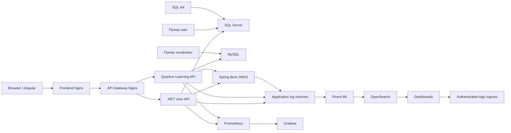

# Architecture and observability inventory

All table entries are **CONFIGURED BUT NOT VERIFIED** behavior from inspected files on 2026-11-12. Version declarations/file existence are VERIFIED source facts; loaded binaries and effective runtime settings are NOT VERIFIED. Published ports below are base defaults, overridable without changing source. Browser is a client, not a Compose service.

## Service inventory

Ports are internal -> loopback published default; dash means no declared published port. Network D = implicit default. LS = log-storage (internal); LU = log-ui (internal); LA = log-access. Optional metrics services join D in development. All actual membership NOT VERIFIED.

| Component / Docker service | Technology and source version | Repository path | Ports | Networks | Health | Authentication / dependencies |
|---|---|---|---|---|---|---|
| Browser / Angular / none | Angular ^22.1.0; Node 24 build image | angular/package.json, package-lock.json, Dockerfile | client / N/A | N/A | N/A | Bearer JWT API client; frontend; actual browser/version NOT VERIFIED |
| Frontend / frontend | digest-pinned nginx stable-alpine; exact Nginx version NOT VERIFIED | angular/nginx.conf, Dockerfile | 8080 -> 8088 | D | /health | static UI public; proxies API to gateway |
| Gateway / gateway | same pinned nginx image | gateway/nginx.conf | 8080 -> 8080 | D | /health | forwards bearer; backend authorization; user-api + vocabulary-api healthy |
| User / user-api | .NET 9; Serilog.AspNetCore 9.0.0, File 7.0.0, prometheus-net 8.2.1 | dotnet/src/JapaneseLearning.User.Api | 8080 -> 8081 | D | /health/ready | RS256 JWT issuer/resource server, roles; SQL Server, successful flyway-user; HTTP JWKS client |
| Learning / vocabulary-api | Quarkus 3.38.2, Java 17, Hibernate Reactive | quarkus/pom.xml, src/main/resources/application.properties | 8080 -> 8082 | D | /q/health/ready | RS256 OIDC resource server; User/Admin; MySQL, flyway-vocabulary, user-api startup ordering; JWKS fetch |
| JWKS / jwks-api | Spring Boot 4.1.2, Java 17, Logback encoder 8.1 dependency | springboot-jwks-api/pom.xml, src/main | 8080 -> 8083; opt-in 9091 unpublished | D | /actuator/health/readiness | public owner-scoped JWKS; read-only public-key binds; no DB |
| MySQL / mysql | 8.4 digest pinned | docker-compose.yml | 3306 -> 3306 | D | authenticated SELECT 1 | DB credentials; vocabulary storage |
| SQL Server / sqlserver | 2022-latest digest pinned; actual CU NOT VERIFIED | docker-compose.yml | 1433 -> 1433 | D | authenticated SELECT 1 | SA credential currently used by app/jobs |
| SQL bootstrap / sqlserver-init | same SQL Server image | docker-compose.yml | none | D | N/A one-shot exit | healthy SQL Server; creates DB; never run in P00 |
| Migration / flyway-user | flyway latest digest pinned; numeric version NOT VERIFIED | dotnet/db/migration | none | D | N/A one-shot exit | SQL Server + sqlserver-init; DB credentials |
| Migration / flyway-vocabulary | same Flyway image | quarkus/src/main/resources/db/migration | none | D | N/A one-shot exit | healthy MySQL; DB credentials |
| Search / opensearch | 3.9.0 digest pinned | observability/logging/Dockerfile.opensearch, opensearch.yml | 9200 -> none | LS | /_cluster/health | security plugin disabled; network isolation; single node |
| Search bootstrap / logging-init | Python 3.14-alpine digest pinned | observability/logging/bootstrap.py | none | LS | N/A one-shot exit | OpenSearch healthy; creates mapping/ISM policy |
| Collector / fluent-bit | 4.2.5 digest pinned | observability/logging/fluent-bit.conf, normalize.lua | 2020 -> none | LS | HTTP health server enabled; no Compose healthcheck | no HTTP auth configured; read-only app logs; logging-init |
| Log UI / opensearch-dashboards | 3.9.0 digest pinned | observability/logging/Dockerfile.dashboards, opensearch-dashboards.yml | 5601 -> none | LS, LU | /api/status | security plugin removed; ingress owns auth; logging-init |
| Log ingress / logs-ui | pinned nginx stable-alpine | observability/logging/nginx.conf | 8080 -> 5601 | LU, LA | /health | htpasswd Basic auth; Dashboards healthy |
| UI bootstrap / logging-ui-init | Python 3.14-alpine | observability/logging/bootstrap.py | none | LU | N/A one-shot exit | creates Discover views; Dashboards healthy |
| Metrics / prometheus | 3.14.0 digest pinned | compose.observability.yml, observability/prometheus.yml | 9090 -> 9090 | D | /-/ready | no auth declared; two API targets; optional overlay |
| Dashboard / grafana | 13.2.2 digest pinned | compose.observability.yml, observability/grafana | 3000 -> 3000 | D | /api/health | admin password required; anonymous/signup off; Prometheus; optional overlay |

Angular lockfile provides resolution metadata, but no install/build was run to establish installed packages. JWKS Java images use mutable 17 tags, unlike most other pinned base images. No external application dependency was established beyond container/package registries at build time; SMTP, external identity provider and hosted telemetry are NOT VERIFIED. External TLS termination is referenced historically but not verified.

Production topology is a separate configured overlay, not observed runtime: frontend=edge+frontend, gateway=frontend+api, user=api+sqlserver, learning=api+mysql, JWKS=api; DB jobs join their DB network. Production removes backend/gateway/DB host ports. Metrics overlay adds Prometheus=api+monitoring and Grafana=monitoring+monitoring-access; Prometheus host port removed. See [Docker source tables](docker-resource-baseline.md). Do not infer jp_dev uses these overlays.

## Per-service storage and telemetry

Volume identifiers here are logical Compose names, not verified engine volume names. Application logs share failure domains with local Docker storage.

| Service(s) | Persistent mounts / logs | Metrics | Tracing |
|---|---|---|---|
| Browser / Angular | N/A browser storage; no server volume | none configured | no browser tracing established |
| frontend, gateway | no named volume; sanitized access stdout, global error stderr, request error log /dev/null | no exporter configured | no explicit Nginx span instrumentation; W3C pass-through NOT VERIFIED |
| user-api | user_api_logs:/app/logs; private signing-key bind read-only; JSON user-api-*.json + stdout | /metrics anonymous internal/debug listener; HTTP/runtime custom registry | Activity IDs logged; fallback random ID is not proof of recorded span; no OTel exporter dependency in API project |
| vocabulary-api | vocabulary_api_logs:/deployments/data/logs; application.json.log + stdout | /q/metrics; Micrometer HTTP/JVM/system/Vert.x | quarkus-opentelemetry; W3C tracecontext; parent-based ratio 0.1; OTLP export false by default; DB/client spans NOT VERIFIED |
| jwks-api | jwks_api_logs:/app/data/logs; read-only public-key file binds; jwks-api.log + stdout | Actuator dependency; opt-in private 9091 /actuator/prometheus; not enabled/scraped by Japanese Compose | Boot OTel starter, W3C, parent-based 0.1; exports disabled; baggage disabled |
| mysql | mysql_data:/var/lib/mysql; Docker stdout and engine files, effective error-log destination NOT VERIFIED | no exporter | N/A server SDK; client DB spans NOT VERIFIED |
| sqlserver | sqlserver_data:/var/opt/mssql including engine logs | no exporter | N/A server SDK; client DB spans NOT VERIFIED |
| sqlserver-init, flyway-user, flyway-vocabulary | stdout; migration directories read-only binds for Flyway; no separate persistent job log | none | none configured |
| fluent-bit | fluent_bit_state:/state; three app log volumes read-only; own logs stdout | HTTP 2020 collector metrics available in config, not scraped | none |
| opensearch | opensearch_data:/usr/share/opensearch/data; own log tmpfs /usr/share/opensearch/logs | no Prometheus exporter/scrape configured | no trace store configured |
| opensearch-dashboards | dashboards_data:/usr/share/opensearch-dashboards/data; console logs | none configured | none configured |
| logs-ui | htpasswd/config read-only binds; stdout/stderr Nginx | none | none |
| logging-init, logging-ui-init | config bind read-only; stdout; no own persistent state | none | none |
| prometheus | prometheus_data:/prometheus; config bind read-only; stdout | self endpoint /metrics exists by technology, no self scrape configured | N/A trace backend |
| grafana | grafana_data:/var/lib/grafana; provisioning/dashboard binds read-only; console and tmp log path | not scraped | no trace datasource configured |

## Existing observability and gaps

**Logging:** .NET safe JSON formatter, request middleware and MediatR behavior provide structured metadata, bounded correlation and exception sanitation. Serilog synchronous unbuffered files rotate daily/100MiB, 30-day and 300-file limits. Quarkus JSON formatter/custom fields provide metadata, safe diagnostics and correlation; console/file async queues each 8192 discard on overflow; files rotate daily/50M, 100 backup cap, application retention setting 30 days. JWKS custom structured Logback encoder rotates 100MB/daily, 30 histories, 2GB archive cap. Live completeness and redaction NOT VERIFIED.

Fluent Bit tails only the three application streams, with persisted offsets and filesystem buffers; full sync/checksum, 32M backlog memory, flush 2s, grace 30s, rotation wait 30s, 1M maximum line and skip-long-lines, unlimited retries, default 1G output limit. Unlimited retry is not unlimited durable capacity. Quarkus input matches active file only; JWKS archives are nested/gz; .NET JSON glob includes rolled JSON files. Rotation, compression and offline collector catch-up need testing; do not claim archive recovery. Nginx, DB and job console logs are not inputs. Normalizer retains original payload (unindexed), so dynamic:false is not a privacy filter. OpenSearch daily indices have 30-day default ISM, 1 shard/0 replicas; source policy is not proof of installed policy or timely deletion.

**Metrics:** Prometheus scrapes .NET and Quarkus every 15s, timeout 5s, evaluation 15s; each target sample limit 5000, body 5MB, 16 labels, value length 128. .NET route/method allowlists, no exemplars and bounded histogram buckets; Quarkus max URI tags 32 and route-family remapping. Quarkus new quiz/admin routes may collapse to /other: validate coverage before extending. Existing Grafana provisioned APIs dashboard should be reused. JWKS metrics already exist in shared source but require deliberate connector/exposure review. No configured DB, gateway, host, collector or Prometheus-self scrape. No measured series budget.

**Tracing:** Quarkus and JWKS dependencies/configuration exist; .NET logs Activity identifiers but full SDK/export/instrumentation not established. No collector, trace storage or trace datasource in Japanese Compose. JWKS HTTP client timeout .NET=5s; no verified client-span chain, DB spans, browser span chain or log-to-trace navigation. Sampling may suppress stored traces even while log IDs exist.

**Alerting:** No rule_files/Alertmanager target in Prometheus source and no provisioned Grafana alert rules/contact points/notification policies found in inspected observability tree. Availability, 5xx, latency, disk, saturation and collector-failure detection/delivery remain gaps. Historic checks do not prove alerts.

**Reliability:** bounded process resources and persistent collector offsets exist; retention is capacity constrained. Single-node search, zero replicas, local volumes, queues dropping on overflow and excluded archives create loss windows. No verified backup/restore, storage capacity, ingestion lag, queue exhaustion rate, RPO/RTO or failure-domain isolation. See [objectives](security-reliability-objectives.md).
