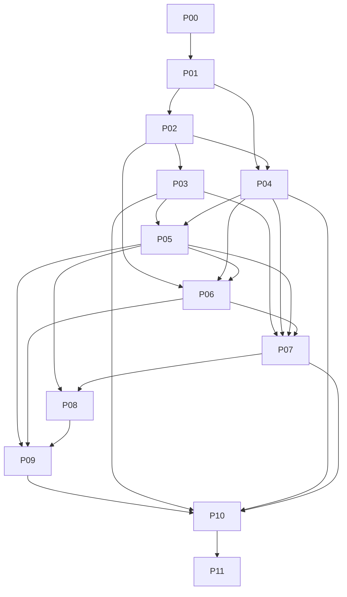

# Implementation roadmap

## P08 implementation progress — 2026-11-14

**P08 PASS for approved local development only.** Actual daily encrypted telemetry/config backups and guarded seven-day retention are configured; the installed monthly task restored an actual daily-task backup with native logs/metrics/traces/dashboards/offsets/collector/alert checks and all 21 original live containers preserved. Conservative actual-event/config RPO **256.445s** and complete local RTO **543.938s** meet approved 24h/4h targets. See [development acceptance](p08-validation/evidence/development-acceptance.json), [policy/exceptions](p08-development-policy.md), [verification](p08-verification.md) and [runbook](p08-recovery-runbook.md). D: is not off-host or independently durable storage; production/off-host acceptance is not claimed. P07's development-only quota exception is unchanged. P09–P11 remain untouched; the overall roadmap is unfinished. Historical P00 authorization/status prose below is retained; the current user instruction authorizes P08 only.

> P01 sequence/dependency and blocker refinements are authoritative: [P01 implementation plan](p01-implementation-plan.md). P00 sequence and disposable-environment design remain historical/reference evidence.

P00 ends with review of this qualified baseline. No later-phase implementation, environment creation or shared repository update is authorized by these documents. Spring Boot observability remains stopped after Phase 6B.

## Dependency order

The diagram shows the principal/transitive path; [quality gates](quality-gates.md) define the complete dependencies and per-phase scope, verification, evidence, exit, rollback and cross-project impact. P10 requires all P03?P09 accepted; P11 requires every prior phase accepted. Dependency metrics may be developed after P01/P02 while log reliability is refined; capacity alerting precedes tracing expansion and expensive failure tests. Secure-by-default requirements apply from P01 onward; P07 is deeper hardening, not permission to expose insecure telemetry earlier.

## Incremental strategy

- **P01 ? Observability Contracts & Quality Gates:** Approve field/route/service registries, producer fixtures, cardinality/privacy budgets, evidence schema and owner decisions; qualify runtime denial and reconcile pins by review, not automatic update.
- **P02 ? Structured Logging & Correlation:** Extend existing Serilog, Quarkus JSON and JWKS encoder only for measured gaps; align identity and safe route mapping; retain headers/contracts.
- **P03 ? Log Collection & Rotation Reliability:** Improve existing Fluent Bit tail/offset/buffer behavior, archive handoff and overflow visibility; include edge logs only via reviewed safe inputs.
- **P04 ? Application & Dependency Metrics:** Reuse prometheus-net, Micrometer and Actuator; add missing JWKS scrape safely and measured DB/gateway/host/collector coverage.
- **P05 ? Early Alerting & Capacity Budgets:** Add minimal availability, error/latency, disk/queue, DB saturation and collector alerts plus approved notification routing.
- **P06 ? Cross-Stack Distributed Tracing:** Complete .NET SDK/client/DB coverage, reuse Quarkus/Boot OTel, approve collector/storage and sampling; link logs to traces.
- **P07 ? Telemetry Security & Storage Hardening:** Harden selected telemetry stores, auth/RBAC/TLS, secrets and quotas incrementally; preserve current ingress restrictions.
- **P08 ? Backup, Restore & Failure Recovery:** Implement approved backups and isolated restore procedures for telemetry/config; coordinate business DB backup interfaces without changing business data.
- **P09 ? Unified Dashboards & Incident Response:** Extend existing Grafana and Discover views with dependency/queue/capacity/trace links; add incident runbooks and owners.
- **P10 ? Isolated Resilience & Performance Validation:** Run bounded failure/load scenarios in dedicated project: collector outage, disk/queue exhaustion, DB dependency failure, trace backend failure, recovery.
- **P11 ? Final Hardening & Production Readiness:** Resolve remaining findings; freeze immutable artifacts, access review, deployment/rollback plan, production-specific acceptance and ownership.

## Future disposable validation environment (design only)

No environment was created or started in P00. Proposed project name: `jp_obs_validation_<UTC timestamp>_<random hex>`; validate characters and explicitly reject `jp_dev`, `springboot_project`, empty names and any existing project collision. Use a generated manifest listing project, owner, unique run ID, candidate image digests, every resource ID/name and expiry. A unique project name alone is insufficient isolation.

Use a standalone reviewed Compose model or fully audited merged model with no inherited external volumes, fixed container names or explicit shared network/volume names. Every network and named volume must be new, project-scoped and labeled with owner/run ID. No Docker socket, host network, privileged mode or host writable bind mounts. Source/config binds only read-only allowlisted paths. Never mount protected DB/log/collector state, keys, certificates, secret directories or backup destinations, even read-only when credentials could enable writes elsewhere. Validate database/JWKS/telemetry endpoints resolve only into the disposable networks; no protected host-published ports as dependencies.

Generate test-only DB/user/dashboard credentials, RSA signing/public key pairs and test certificates in the future disposable workspace; never read, copy or regenerate existing keys. Generation is not part of P00. Test databases start empty or use approved synthetic fixtures; no production/user data. Each parent stack candidate uses its own environment and credentials, never a shared writable JWKS deployment.

Declare CPU/memory/PID limits, log rotation, collector/store retention and hard storage quotas backed by a verified bounded filesystem/device. Compose named volumes and memory limits alone are not storage bounds. Proposed maximum test storage 5GiB total and maximum 15-minute load windows require approval and sizing; reject the test if hard storage bounds cannot be established. Reserve host capacity so disposable pressure cannot saturate the shared engine; disk-full experiments require an isolated bounded backing store and must not fill the Docker Desktop disk. Use ephemeral loopback ports, restricted ingress and independent alert test destinations. Fault injection is scoped to manifest-owned IDs only, with rate ceilings, headroom preflight and automatic stop thresholds.

Preflight: capture protected project IDs/start times/mount identities without env values; compare every candidate mount/network/source/endpoint against protected inventory. Reject aliases, symlink escapes, shared external resources or unverified identity. When protected runtime inventory is inaccessible, destructive validation is blocked. Validate resulting model without printing secrets.

Cleanup guards: require exact manifest project/run ID and ownership label match for every selected ID; reject protected names/IDs and anything not manifest-owned. Never broad prune or ambiguous project-wide deletion. Cleanup is limited to created disposable resources under separately authorized test scope. Preserve evidence outside cleanup scope; verify protected IDs/start times/mounts unchanged afterward. Cleanup and rollback must not touch pre-existing volumes or data. Document incomplete cleanup instead of broadening deletion selectors.

## Review decisions and next action

Approve/adjust canonical service/environment names, error taxonomy, SLO and retention proposals, privacy policy, access roles, resource budgets, backup ownership and notification destinations. Establish normal read-only runtime access and record effective Compose overlay order. Resolve parent-pin drift through a separate reviewed dependency decision; do not auto-update JWKS. P01 is the recommended next task after P00 review. No business-approved thresholds or runtime readiness claims are established here.
