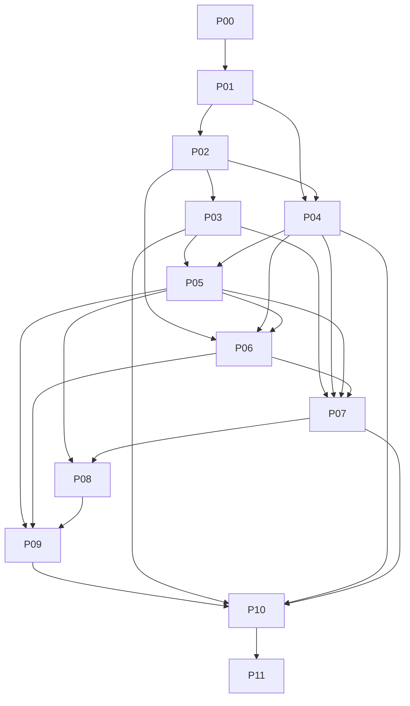

## Final local implementation handover — 2026-11-15

**OBSERVABILITY LOCAL IMPLEMENTATION: CLOSED WITH KNOWN LIMITATIONS**  
**P11 LOCAL ACCEPTANCE: 11/15 PASS**  
**P11 PRODUCTION ACCEPTANCE: PARTIAL/BLOCKED**  
**PRODUCTION READINESS: NOT APPROVED**

Closed by explicit user decision. P00-P10 PASS and original scopes remain intact. LD-09 FAIL; LD-10/LD-11/LD-14 BLOCKED; other11 gates PASS. Four unresolved gates are deferred, not waived. See [final handover and reopening conditions](p11-local-development-acceptance.md) and [machine record](p11-validation/local-development-acceptance.json). No further implementation/testing/runtime actions. Earlier entries below are historical; original production criteria/evidence remain unchanged.

## LD-09 Tempo backup remediation — pending server qualification

**P11-LOCAL-DEV remains BLOCKED:11 PASS/1 FAIL/3 BLOCKED/0 NOT VERIFIED.** Afternoon isolated six-store qualification PASS:620 manifest files,600 traces,2057 samples,3 dashboards,3 SQLite integrity checks; cached native-trace provenance recorded. Active Tempo unchanged; LD-09 needs separate restart/change approval and active backup proof. LD-10/14 lack full-stack capacity; LD-11 lacks approved independent SDK9.0.317 execution. All52/25/three backups preserved;15 owned resources cleaned. [Current local evidence](p11-local-development-acceptance.md). Original production PARTIAL/BLOCKED; readiness NOT APPROVED.

## Separate local development final acceptance — P11-LOCAL-DEV

**Local acceptance: BLOCKED** (11 PASS/1 FAIL/3 BLOCKED/0 NOT VERIFIED across15 mandatory local gates). [Local matrix and evidence](p11-local-development-acceptance.md), [local machine result](p11-validation/local-development-acceptance.json). Daily backup retry failed safely; full .NET151 regression remains policy-blocked; current-candidate rollback/startup proof is not verified. P00-P10 retain PASS in their existing scopes; local final completion is pending. **Original P11 production: PARTIAL; production acceptance: BLOCKED; readiness: NOT APPROVED.** Original20-clause matrix and production acceptance records are unchanged. No12/12 production completion or unconditional P11 PASS is claimed.

## Final local P11 closure review — 2026-11-15

**P11 PARTIAL; production BLOCKED; 11/12.** The [definitive 20-requirement matrix](p11-readiness.md) preserves every original mandatory gate and names missing decisions. Local SDK9.0.317 plus five NuGet lockfiles now restore offline from 168 existing packages; two publishes match 101 files and 202 independent hashes. 23 local regression checks and 9 result-gate checks pass. Full 151-case .NET execution remains BLOCKED by policy with no approved independent runner. Historical patch-provenance/byte-check failures are retained; exact six-file transfer package and corrected scratch patch handling are documented. All 52 containers / 25 volumes / three backups/tasks/revisions and observed JWT file hashes compare unchanged; active DB/telemetry bytes are not claimed identical. Shared pins/overlay stay unchanged/inactive. Production host/security/recovery, tested rollback/handover and accountable business/release approvals remain absent.

## Current independent .NET environment qualification — 2026-11-15

**P11 PARTIAL; production BLOCKED; 11/12.** [Independent test specification and approval request](p11-dotnet-environment.md) records no established approved independent runner. Static inventory is 151 expected cases across 62 methods/16 classes; runtime discovery is not claimed. Nine offline result-gate checks and 443 retained artifact/manifest/source hash checks pass. Security-owner approval of environment/image, dependency closure, isolation, resource limits and evidence handling is pending; no workload or image was downloaded/executed. Latest Windows regression remains 14 passed/65 policy-blocked failures. All 52 containers, 25 volumes, three backups, schedules and revisions compare unchanged. Owner overlay stays inactive and JWKS pins unchanged. Earlier evidence below remains historical.

## Current .NET diagnosis and rollout gate — 2026-11-15

**P11 PARTIAL; production BLOCKED; 11/12.** [Execution diagnosis and ordered JWKS rollout/rollback proposal](p11-dotnet-rollout-readiness.md) confirms Code Integrity policy denial in all 65 failed .NET records. Two enum-valued theory discovery errors explain the 81-to-79 count; no independent code assertion failure is established. Existing signed SDK was already used; no approved alternative execution environment is established. Fresh selected and full-solution regression remain BLOCKED; no new test execution or runtime migration occurred. The owner overlay remains inactive and pins unchanged. All 52 containers, 25 volumes, three backups, schedules and revisions compare unchanged. Explicit deployment approval and all remaining production gates remain required. Earlier evidence below remains historical.

## Current Spring source migration — 2026-11-15

**P11 PARTIAL; production BLOCKED; 11/12.** [Spring migration and regression](p11-spring-migration.md) now records actual source adoption: opt-in two-path owner overlay, test-only order correction, unchanged pins and inactive rollout. Fresh Learning 25/25, User 26/26, JWKS 21/21 and Quarkus 21/21 pass. Fresh .NET is NOT PASS: Application Control blocks the Domain DLL (14 passed, 65 failed; discovery errors, expected 81 not met). Existing real-token/gateway proof remains valid without another login. Two Learning builds match and independent hashes pass; [candidate manifest](p11-validation/spring-release-manifest.json) identifies the uncommitted source and artifacts. All 52 containers, 25 volumes, three backups, schedules and revisions are preserved. Production/shared-publisher adoption and remaining authoritative gates stay open. Earlier statements below are historical and are superseded within this explicit scope.

# P11 readiness review — 2026-11-15

**P11 PARTIAL; production acceptance BLOCKED.** [Actual .NET-issued token -> existing Quarkus proof](p11-live-token.md) now **PASS** with the provided development account: direct/gateway requests succeed, both APIs deny User-to-Admin access, and the new refresh session is logged out. No credentials/keys/claims changed and no tokens persisted. [Spring consumer closure](p11-consumer-closure.md) retains the opt-in two-path migration and **44/44 passing** correction candidate, not adopted/deployed source. Native Application Control, remaining negative/regression scope, release qualification, production/ownership/signoff gates remain open. [Prior release](p11-jwks-release.md) and [remediation](p11-technical-remediation.md) evidence remain intact. All 52 containers, 25 volumes, backups, schedules and revisions are preserved; normal login/logout and telemetry advancement is explicit. See [readiness](p11-readiness.md), [verification](p11-verification.md) and [acceptance](p11-validation/acceptance.json). P00–P10 retain development acceptance; **11/12 phases complete**. Earlier status statements below are historical.

# P10 completed resilience validation — 2026-11-14

**P10 PASS for approved local development.** The remaining [full native multi-store recovery](p10-full-recovery.md) passed fresh resource/isolation guards and actual encrypted checkpoint integrity: **1,867 logs, 828,320 metric samples, 271 trace payloads, one backed-up dashboard/datasources, collector offsets/resumed ingestion and isolated alert firing/resolution**. Measured **RPO 34,403.272s / RTO 544.245s** satisfy 24h/4h targets. Resource caps and sampled Windows headroom pass; exact owned cleanup and all 52 original containers, original volumes, backups, schedules and revisions are preserved. [Immutable acceptance](p10-validation/evidence/jp_obs_validation_20261114150620_955b6d3f/acceptance.json) retains prior native outage, ENOSPC correction, privacy and retention evidence, including all failures. **11/12 phases complete; P11 remains unstarted and untouched.** Existing local exceptions/loss boundaries remain explicit; production readiness is not claimed.

# P10 approved WSL2 maintenance — 2026-11-14

**P10 PARTIAL.** The [approved 9 GiB WSL2 change and single controlled interruption](p10-wsl-maintenance.md) completed, preserving all 52 container identities, original volumes, backups, schedules and revisions. All development services recovered; expected start-time changes are recorded. Engine headroom now passes (**4,848.480 MiB**), but Windows available RAM fails (**463.957 / 1,024 MiB required; deficit 560.043 MiB**). Full multi-store recovery was not executed, with no new recovery peaks or RPO/RTO claimed. Prior accepted evidence remains valid. **10/12 phases complete; P11 remains unstarted.**

# P10 safe memory investigation — 2026-11-14

**P10 PARTIAL; full recovery remains capacity blocked.** The [fresh investigation](p10-memory-investigation.md) measures **3,471.542 MiB available / 3,680 MiB required**, a **208.458 MiB deficit**. All other guards and preservation checks pass for 52 existing containers, volumes, backups, schedules and revisions. No abandoned P10 runtime was verified, nothing was reclaimed or restarted, and no memory configuration changed. Full recovery was not executed. The proposed future WSL 9 GiB ceiling requires separate approval for an infrastructure maintenance interruption. Prior evidence and approved budgets remain intact. **10/12 phases complete; P11 unstarted.**

# P10 file audit and approved recovery preflight — 2026-11-14

**P10 PARTIAL; full-recovery execution BLOCKED by capacity.** The user approved the 4 GiB recovery envelope. File audit/consolidation preserves all history with no removals; 49 exact duplicate paths are retained in a verified archive. A fresh read-only guard measured **3,435.576 MiB available versus 3,680 MiB required**, so no recovery resources were created. All 52 original containers, volumes, backups, schedules and revisions are preserved. See [audit, categories and guard evidence](p10-file-audit.md). Prior native passes remain valid; **10/12 phases complete, P11 unstarted**. Earlier authorization/progress paragraphs below are historical.

# P10 ENOSPC resolution progress — 2026-11-14

**P10 PARTIAL for local development.** The bounded deterministic-ID source/search recovery candidate reconciles the native ENOSPC cohort (20/20 final unique documents, zero missing/duplicates); new outage-privacy and native retention/source-ack boundaries pass. Full multi-store recovery is not executed: the known reference exceeds current storage/data/request caps, and its proposed memory reserve is not currently available. See [resolution and precise proposal](p10-resolution.md). All prior P10 passes/failures, approved limits and P07/P08 policies remain intact. **10/12 phases complete; P11 remains unstarted and untouched.** No production readiness claim.

# P10 integrated continuation progress — 2026-11-14

**P10 PARTIAL for local development.** Approved budgets are recorded; native Fluent Bit/OpenSearch and Collector/Tempo outages, Prometheus/Grafana datasource failure, synthetic dependency/JWT checks, native alert grouping/resolution, offsets/restart and limited encrypted logical restore executed. Native queue pressure leaves 12 sequenced events missing; full recovery/privacy/retention acceptance remains incomplete. All 52 original containers and original volume identities, P08 schedules and backup artifacts are preserved. See [current verification](p10-verification.md), [scenario matrix](p10-continuation.md) and [machine acceptance](p10-validation/evidence/continuation-acceptance.json). P00–P09 remain complete for applicable development scopes (**10/12**); P11 remains unstarted and untouched. No production readiness claim. Earlier progress/authorization paragraphs below remain historical evidence.

# P10 validation progress — 2026-11-14

**P10 BLOCKED for integrated acceptance.** Read-only baseline, encrypted backup authentication, 13 source guard checks and bounded 8 MiB synthetic tmpfs/queue checks executed. All 52 pre-existing containers (21 development containers) preserved. Native outage/load/notification/recovery scenarios remain NOT VERIFIED pending approved workload/fault/loss/performance budgets required by the P01 P10 gate. See [P10 verification and acceptance matrix](p10-verification.md). P07/P08 development exceptions unchanged. P00–P09 remain complete for applicable development scopes (10/12); P11 remains unstarted and untouched. Historical authorization paragraphs below remain prior-phase evidence; current user authorization covers P10 only.

# Implementation roadmap

## P09 implementation progress — 2026-11-14

**P09 PASS for `jp_learning_dev` local development.** Unified Dashboards & Incident Response adds two provisioned Grafana dashboards (20 query panels), three reproducible Discover views and owned incident runbooks. All 63 native panel assertions, live datasource/query/provisioning checks and 24 isolated authorization/incident/restart checks pass. All 21 existing container identities, start times, restart counts, states and mounts are preserved; no live recreation/restart, P08 task or backup-data change. See [scope and inventory](p09-implementation.md), [verification](p09-verification.md), [runbooks](p09-incident-runbooks.md) and [machine acceptance](p09-validation/evidence/acceptance.json). Missing signals remain explicit gaps. P07/P08 development exceptions remain unchanged; production readiness is not claimed. P00–P09 are complete for applicable development scopes (10/12); P10/P11 remain unstarted. The historical P08 status/authorization paragraph below is retained as prior-phase evidence; the current instruction authorizes P09 only.

## P08 implementation progress — 2026-11-14

**P08 PASS for approved local development only.** Actual daily encrypted telemetry/config backups and guarded seven-day retention are configured; the installed monthly task restored an actual daily-task backup with native logs/metrics/traces/dashboards/offsets/collector/alert checks and all 21 original live containers preserved. Conservative actual-event/config RPO **256.445s** and complete local RTO **543.938s** meet approved 24h/4h targets. See [development acceptance](p08-validation/evidence/development-acceptance.json), [policy/exceptions](p08-development-policy.md), [verification](p08-verification.md) and [runbook](p08-recovery-runbook.md). D: is not off-host or independently durable storage; production/off-host acceptance is not claimed. P07's development-only quota exception is unchanged. P09–P11 remain untouched; the overall roadmap is unfinished. Historical P00 authorization/status prose below is retained; the current user instruction authorizes P08 only.

> P01 sequence/dependency and blocker refinements are authoritative: [P01 implementation plan](p01-implementation-plan.md). P00 sequence and disposable-environment design remain historical/reference evidence.

P00 ends with review of this qualified baseline. No later-phase implementation, environment creation or shared repository update is authorized by these documents. Spring Boot observability remains stopped after Phase 6B.

## Dependency order

The diagram shows the principal/transitive path; [quality gates](quality-gates.md) define the complete dependencies and per-phase scope, verification, evidence, exit, rollback and cross-project impact. P10 requires all P03?P09 accepted; P11 requires every prior phase accepted. Dependency metrics may be developed after P01/P02 while log reliability is refined; capacity alerting precedes tracing expansion and expensive failure tests. Secure-by-default requirements apply from P01 onward; P07 is deeper hardening, not permission to expose insecure telemetry earlier.

## Incremental strategy

- **P01 ? Observability Contracts & Quality Gates:** Approve field/route/service registries, producer fixtures, cardinality/privacy budgets, evidence schema and owner decisions; qualify runtime denial and reconcile pins by review, not automatic update.
- **P02 ? Structured Logging & Correlation:** Extend existing Serilog, Quarkus JSON and JWKS encoder only for measured gaps; align identity and safe route mapping; retain headers/contracts.
- **P03 ? Log Collection & Rotation Reliability:** Improve existing Fluent Bit tail/offset/buffer behavior, archive handoff and overflow visibility; include edge logs only via reviewed safe inputs.
- **P04 ? Application & Dependency Metrics:** Reuse prometheus-net, Micrometer and Actuator; add missing JWKS scrape safely and measured DB/gateway/host/collector coverage.
- **P05 ? Early Alerting & Capacity Budgets:** Add minimal availability, error/latency, disk/queue, DB saturation and collector alerts plus approved notification routing.
- **P06 ? Cross-Stack Distributed Tracing:** Complete .NET SDK/client/DB coverage, reuse Quarkus/Boot OTel, approve collector/storage and sampling; link logs to traces.
- **P07 ? Telemetry Security & Storage Hardening:** Harden selected telemetry stores, auth/RBAC/TLS, secrets and quotas incrementally; preserve current ingress restrictions.
- **P08 ? Backup, Restore & Failure Recovery:** Implement approved backups and isolated restore procedures for telemetry/config; coordinate business DB backup interfaces without changing business data.
- **P09 ? Unified Dashboards & Incident Response:** Extend existing Grafana and Discover views with dependency/queue/capacity/trace links; add incident runbooks and owners.
- **P10 ? Isolated Resilience & Performance Validation:** Run bounded failure/load scenarios in dedicated project: collector outage, disk/queue exhaustion, DB dependency failure, trace backend failure, recovery.
- **P11 ? Final Hardening & Production Readiness:** Resolve remaining findings; freeze immutable artifacts, access review, deployment/rollback plan, production-specific acceptance and ownership.

## Future disposable validation environment (design only)

No environment was created or started in P00. Proposed project name: `jp_obs_validation_<UTC timestamp>_<random hex>`; validate characters and explicitly reject `jp_dev`, `springboot_project`, empty names and any existing project collision. Use a generated manifest listing project, owner, unique run ID, candidate image digests, every resource ID/name and expiry. A unique project name alone is insufficient isolation.

Use a standalone reviewed Compose model or fully audited merged model with no inherited external volumes, fixed container names or explicit shared network/volume names. Every network and named volume must be new, project-scoped and labeled with owner/run ID. No Docker socket, host network, privileged mode or host writable bind mounts. Source/config binds only read-only allowlisted paths. Never mount protected DB/log/collector state, keys, certificates, secret directories or backup destinations, even read-only when credentials could enable writes elsewhere. Validate database/JWKS/telemetry endpoints resolve only into the disposable networks; no protected host-published ports as dependencies.

Generate test-only DB/user/dashboard credentials, RSA signing/public key pairs and test certificates in the future disposable workspace; never read, copy or regenerate existing keys. Generation is not part of P00. Test databases start empty or use approved synthetic fixtures; no production/user data. Each parent stack candidate uses its own environment and credentials, never a shared writable JWKS deployment.

Declare CPU/memory/PID limits, log rotation, collector/store retention and hard storage quotas backed by a verified bounded filesystem/device. Compose named volumes and memory limits alone are not storage bounds. Proposed maximum test storage 5GiB total and maximum 15-minute load windows require approval and sizing; reject the test if hard storage bounds cannot be established. Reserve host capacity so disposable pressure cannot saturate the shared engine; disk-full experiments require an isolated bounded backing store and must not fill the Docker Desktop disk. Use ephemeral loopback ports, restricted ingress and independent alert test destinations. Fault injection is scoped to manifest-owned IDs only, with rate ceilings, headroom preflight and automatic stop thresholds.

Preflight: capture protected project IDs/start times/mount identities without env values; compare every candidate mount/network/source/endpoint against protected inventory. Reject aliases, symlink escapes, shared external resources or unverified identity. When protected runtime inventory is inaccessible, destructive validation is blocked. Validate resulting model without printing secrets.

Cleanup guards: require exact manifest project/run ID and ownership label match for every selected ID; reject protected names/IDs and anything not manifest-owned. Never broad prune or ambiguous project-wide deletion. Cleanup is limited to created disposable resources under separately authorized test scope. Preserve evidence outside cleanup scope; verify protected IDs/start times/mounts unchanged afterward. Cleanup and rollback must not touch pre-existing volumes or data. Document incomplete cleanup instead of broadening deletion selectors.

## Review decisions and next action

Approve/adjust canonical service/environment names, error taxonomy, SLO and retention proposals, privacy policy, access roles, resource budgets, backup ownership and notification destinations. Establish normal read-only runtime access and record effective Compose overlay order. Resolve parent-pin drift through a separate reviewed dependency decision; do not auto-update JWKS. P01 is the recommended next task after P00 review. No business-approved thresholds or runtime readiness claims are established here.
