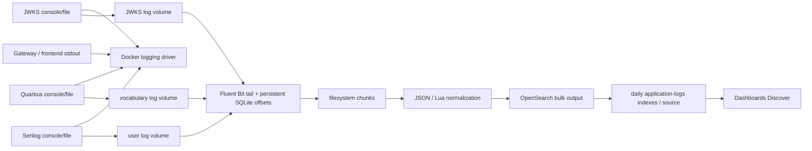

# P03 pipeline architecture

2026-11-13. Source audit and inactive proposals only. [P01 contract](p01-observability-contract.md)
is authoritative; [P00 Docker baseline](docker-resource-baseline.md) and
[P02 implementation](p02-logging-implementation.md) retain their runtime qualifications.
No source observation below proves deployed behavior.

The diagram is logical, not an assertion of exact internal filter/chunk ordering. Raw
input persistence can precede filtering. Docker logs are a parallel diagnostic stream,
not an input to this collector. There is no edge-log collection path in current source.

## Producer boundaries

| Boundary | Format, time, identity/context/error/types | Limits, buffering/retry/failure and risks |
|---|---|---|
| .NET -> console/file | SafeJsonFormatter NDJSON: native Timestamp/Level/Properties plus P02 aliases; UTC canonical milliseconds; user-api tag binds service; validated correlation and active context; typed safe error metadata; numeric status/duration, booleans | synchronous unbuffered file; daily/100MiB rolling defaults, 300 files/30 days; no collector acknowledgement; local I/O/retention can lose data; future generic text remains privacy risk |
| Quarkus -> console/file | official JSON; @timestamp UTC configured milliseconds; native service.*, canonical aliases, MDC correlation, valid context, classified safe errors; numeric aggregates, legacy string flags | two independent 8192 async discard queues; 50M size + date gzip, 100 backup index default, retention worker 30 days; discard/kill/early compression loss; no sink retry contract |
| JWKS -> console/file (read-only) | StructuredJsonEncoder NDJSON; @timestamp, service/serviceVersion/environment, event/correlation/trace/span and typed durationMs/error fields; missing instance remains missing | active jwks-api.log; archive subdirectory .log.gz; 100MB/30 history/2GB cap and startup cleanup; unread archives/retention/producer crash risk; peer/caller fields remain privacy concern |
| Gateway -> Docker | current text: remote address/time_local/family/status/seconds/correlation; no span; startup stderr + sanitized request-access policy | stdout only, no file spool input; peer privacy risk; not canonical; driver retention can expire unread logs |
| Frontend -> Docker | P02 build-input escaped JSON; time_iso8601 offset/no milliseconds; static family, status/duration numeric, correlation; no spans | stdout only, no collector mount/input; metadata incomplete; built image/effective config NOT VERIFIED |
| Gateway candidate -> hypothetical Docker | gateway/nginx.p02.conf escaped JSON as frontend; static outcome/upstream strings; no schema stamp | inactive and unreferenced; no syntax/runtime acceptance; no automatic activation |

## Collector/storage boundaries

| Boundary | Input -> output, fields/time/types | Reliability/privacy behavior |
|---|---|---|
| Docker -> driver | stdout/stderr -> daemon-managed storage; wrapper/time is driver-specific | base app driver unspecified; logging infrastructure local 10m x5; production overlay local 10m x5 apps/jobs. JSON-file rotation NOT VERIFIED. Do not tail local-driver binary/compressed storage as JSON. No daemon changes |
| app volumes -> tail | /logs/jwks/*.log; /logs/user/user-api-*.json; /logs/vocabulary/application.json.log -> application_json | disjoint mounts/tags; DB per input in /state; Full sync, read head, refresh 2s, rotate wait 30s; 1M line cap/skip; default per-file buffers + file-count growth; no compressed replay. No overlapping console input |
| parser -> filter | JSON object -> native fields, malformed fallback may carry log; no parser Time_Key | event timestamp stays field; collector timestamp independent; nested objects remain until filter; malformed fallback/raw bytes pose privacy risk |
| current Lua -> output | flattened native aliases, normalized numeric/boolean fields; service from tag; native Timestamp/@timestamp else collector fallback; incomplete metadata | canonical P02 snake-case aliases often ignored; uri/RequestPath fallback, original=record, peer/caller copies; unvalidated trace provenance; new candidate described separately |
| buffers -> OpenSearch | filesystem chunks -> bulk index; collected_at output time, current-day index, prefix per tag | full sync/checksum, 32M backlog memory, 1G default per-output cap, Retry_Limit False, Grace 30s. Oldest chunks discarded at cap; no host hard quota; Generate_ID reduces same-retry duplicates, not replay/exactly-once. Per-item rejection/query visibility unmeasured |
| index template -> stored document | dynamic:false; dates @timestamp/collected_at, keywords context/error/route, integer status/peer_port, double duration, boolean flags, text message, original object enabled:false | original still in _source/backups. New fields may be stored but unsearchable. Existing mappings, installed templates and rejected bulk types NOT VERIFIED; no live migration |
| ISM -> retention | application-logs-* daily indexes, 30-day default from creation, delete state | existing source retained unchanged; cap/age is not guaranteed oldest-event retention, especially replay indexed by current day; no bootstrap/retention operations executed |
| stored fields -> readers | combined/per-service Discover patterns for three APIs, time field @timestamp | no frontend/gateway-specific patterns; original reader exists in scripts/verify-logging.py; canonical new fields absent from mapping. Existing dashboards/search compatibility remains NOT VERIFIED |

Collector image source pins Fluent Bit 4.2.5 and a digest. Actual image/config identity is
NOT VERIFIED. Configuration is copied into the image, not directly mounted by fluent-bit;
the logging directory is nevertheless a declared /config:ro bind source for initializer
services. It was therefore left byte-identical, as were gateway bind sources.

Official semantics consulted: [Tail 4.2](https://docs.fluentbit.io/manual/4.2/data-pipeline/inputs/tail),
[buffering](https://docs.fluentbit.io/manual/data-pipeline/buffering),
[Lua](https://docs.fluentbit.io/manual/data-pipeline/filters/lua), and
[OpenSearch output 4.2](https://docs.fluentbit.io/manual/4.2/data-pipeline/outputs/opensearch).
Version-specific acceptance still requires execution of the pinned image.
