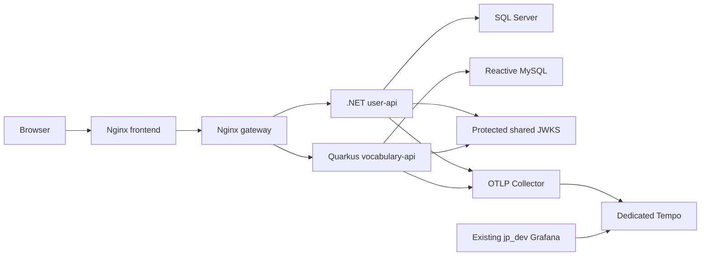

# P06 tracing architecture

Source candidate, 2026-11-13. Authority: P01 contract and gates, narrowed by the P06 task.
No deployment is authorized by these files. See [verification](p06-verification.md).

There is no existing User-to-Learning business HTTP call. P06 does not invent one.
Backend HTTP instrumentation is compatible at either end of a future call. Existing actual
outbound dependencies are JWKS fetches; cache hits must not manufacture HTTP spans.
The two APIs are separate trace roots unless a caller supplies shared valid context.

Nginx remains a transparent proxy without invented spans. Both proxy configurations use
default request-header forwarding and do not override traceparent/tracestate. Source
pass-through needs no edit; effective proxy configuration and runtime forwarding remain
unverified. The inactive gateway/nginx.p02.conf is untouched. Browser instrumentation is
deferred pending reviewed CORS, privacy, origin, authentication and sampling design.

User API adds a single OTel provider for native ASP.NET Core, HttpClient and SqlClient.
Quarkus 3.38.2 retains its existing extension, Vert.x HTTP and reactive SQL instrumentation.
No Java agent, JDBC conversion, manual request span, second metrics provider or duplicate
HTTP/SQL hook is introduced. Existing P02 correlation/logging and P04 metrics remain owners.

Service namespace is japanese-learning; service names are user-api and vocabulary-api.
Version is trusted release configuration or explicit unknown. Environment is externally
configured, with the root development Compose using LOG_ENVIRONMENT. Instance identity is
process/runtime metadata, never a user identity. Existing native log resource envelopes are
preserved; their historical casing/defaults can differ from the new trace environment.
Before release, reconcile environment/version/instance values with P02 canonical metadata.

Collector 0.145.0 is justified by export scrubbing, bounded buffering and private routing.
Tempo 2.10.3 supplies the missing trace store and native Grafana Explore integration without
duplicating OpenSearch logs. Both Linux amd64 image manifests were checked and pinned by
digest. This does not prove vulnerability freedom or runtime image compatibility.

Collector joins jp_dev default for API ingestion and new internal p06-tracing for Tempo.
Tempo joins only p06-tracing; Grafana adds that network while retaining both existing ones.
No tracing host ports or external networks are declared. Project-scoped tempo_data is new;
no Spring Boot network, Collector, Tempo, queue or storage volume is referenced. Collector
uses memory only; persistence of retry data is deliberately not promised.

Shared JWKS source, gitlink, keys, endpoints and validation remain unchanged. Propagation
can use existing client transports and the shared server's existing tracing; no shared edit
is needed to prepare P06. Actual OIDC/JWKS fetch parentage and dual-consumer runtime
compatibility remain unverified. Any future shared source edit requires the governance gate.

References: [Quarkus tracing](https://quarkus.io/guides/opentelemetry-tracing/),
[Collector release](https://github.com/open-telemetry/opentelemetry-collector-releases/releases/tag/v0.145.0),
[Tempo release](https://github.com/grafana/tempo/releases/tag/v2.10.3).
